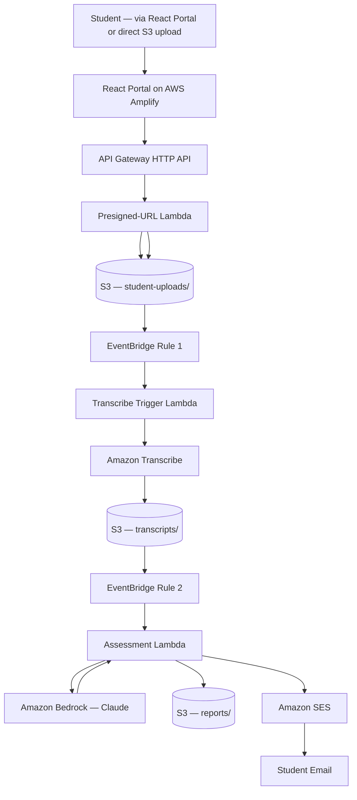
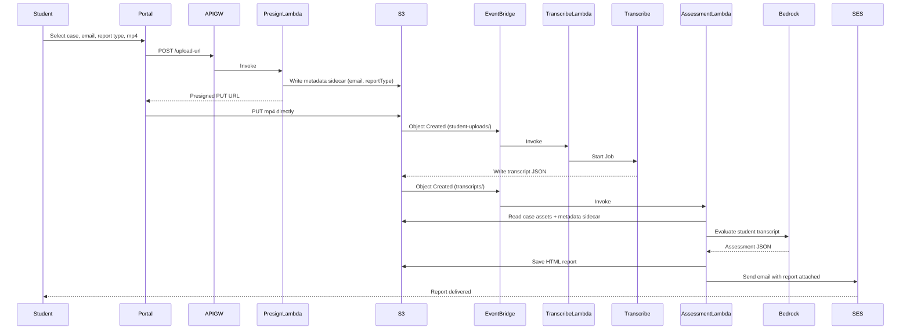
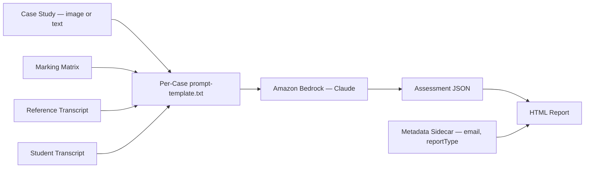

# 🦷 Dental AI Tutor

> AI-powered dental examination assessment platform built on AWS. Students upload a recording — or use the live web portal — and the platform automatically transcribes it, evaluates performance against reference answers and official marking rubrics, generates an examiner-style report, and emails feedback back to the student, all with zero manual steps.

**Live portal:** [Plan Ore Academy](https://main.d2irwx8vfe7n21.amplifyapp.com) — students select a case, enter their email, choose a report type, and upload their recording directly from the browser.

---

# 📚 Table of Contents

- [Overview](#-overview)
- [Business Problem](#-business-problem)
- [What's Actually Live vs. Planned](#-whats-actually-live-vs-planned)
- [End-to-End Architecture](#️-end-to-end-architecture)
- [Sequence Diagram](#-sequence-diagram)
- [Assessment Pipeline](#-assessment-pipeline)
- [AWS Services](#️-aws-services)
- [Repository Structure](#-repository-structure)
- [S3 Bucket Structure](#-s3-bucket-structure)
- [Case Configuration](#-case-configuration)
- [Upload Flow](#-upload-flow)
- [Transcription Flow](#-transcription-flow)
- [Assessment Flow](#-assessment-flow)
- [Example Assessment Output](#-example-assessment-output)
- [Report Generation](#-report-generation)
- [Email Delivery](#-email-delivery)
- [React Portal](#-react-portal)
- [Deployment Guide](#-deployment-guide)
- [IAM Permissions](#-iam-permissions)
- [Monitoring & Observability](#-monitoring--observability)
- [Security](#-security)
- [Cost Considerations](#-cost-considerations)
- [Lessons Learned](#-lessons-learned)
- [Roadmap](#️-roadmap)
- [Disclaimer](#️-disclaimer)

---

# 🎯 Overview

Dental AI Tutor is designed to help dental students prepare for ORE- and LDS-style examinations (OSCE and DTP stations).

The platform:

1. Accepts a student MP4 recording — uploaded via the web portal or directly to S3.
2. Automatically transcribes speech using Amazon Transcribe.
3. Compares the student's performance against:
   - Case study (image or text)
   - Official marking matrix
   - Reference transcript (model answer)
   - Student's own transcript
4. Evaluates clinical reasoning, communication, and delivery.
5. Generates an examiner-style score, grade, strengths, and areas for improvement.
6. Stores the report in Amazon S3.
7. Emails the report to the student — either the address they typed into the portal, or a default academy address for manually-triggered runs.

---

# ❓ Business Problem

Manual evaluation of clinical case presentations is:

- Time-consuming
- Difficult to scale
- Subject to examiner variation
- Expensive for training providers

Dental AI Tutor provides:

- Consistent, rubric-based evaluation
- Feedback within minutes of upload, not days
- Scalable to hundreds of cases and students with no added examiner load
- Confidence/delivery analysis alongside clinical scoring
- A free, low-friction Stage 1 for enrolled students, with a paid live-roleplay Stage 2 planned

---

# ✅ What's Actually Live vs. Planned

This README previously described the target architecture. As of the latest deployment, the following is **live and working end-to-end**, not just planned:

| Component | Status |
|---|---|
| S3-based case configuration (per-case assets, no hardcoded logic) | ✅ Live — 3 cases |
| Transcribe Trigger Lambda, EventBridge-driven | ✅ Live |
| Assessment Lambda (Bedrock scoring, HTML report, email) | ✅ Live |
| Fully automated pipeline (upload → email, zero manual invocation) | ✅ Live |
| `reportType` toggle (detailed / basic) | ✅ Live |
| React portal (case dropdown, email, report type, upload) | ✅ **Live**, deployed on AWS Amplify |
| Presigned-URL Lambda + API Gateway | ✅ Live |
| Per-student metadata sidecar (email/report type survive the async Transcribe hop) | ✅ Live |
| Email delivery via **Amazon SES** (not SNS) | ✅ Live |
| PDF reports | ❌ Not built — HTML only |
| Cognito auth / faculty dashboard / DynamoDB | ❌ Not built — see [Roadmap](#️-roadmap) |
| Bedrock Knowledge Base / RAG | ❌ Deliberately not planned yet — see [Roadmap](#️-roadmap) |

A few things differ from the original design on purpose:

- **Amazon SES**, not SNS, sends the report emails — SES supports rich HTML email with an attachment, which SNS does not do natively.
- The React portal is not a Phase 4 item — it's built, deployed, and is the primary way students interact with the platform today.
- Prompt templates and marking matrices are **per-case files in S3**, not a single shared `prompts/examiner-prompt.txt` — this lets each case have its own examiner persona, scoring philosophy, and criteria with zero code changes.

---

# 🏗️ End-to-End Architecture




---

# 🔄 Sequence Diagram




---

# 🧠 Assessment Pipeline




Every case supplies its own `prompt-template.txt`, so the examiner persona, scoring philosophy, deduplication rules, and sample output format can all differ per case with **no Lambda code changes** — the Lambda only ever loads whatever `cases/{caseId}/` contains.

---

# ☁️ AWS Services

| Service | Purpose |
|---|---|
| Amazon S3 | File storage — case assets, uploads, transcripts, reports, metadata sidecars |
| Amazon EventBridge | Event routing between upload → transcribe → assessment stages |
| AWS Lambda | Serverless processing (4 functions — see below) |
| Amazon Transcribe | Speech-to-text |
| Amazon Bedrock | AI evaluation (Claude) |
| Amazon SES | HTML email delivery with report attachment |
| Amazon API Gateway | HTTP API fronting the presigned-URL Lambda |
| AWS Amplify | Hosting for the React portal |
| Amazon CloudWatch | Logging & monitoring |
| Amazon SQS | Dead-letter queue for EventBridge invoke failures |
| AWS IAM | Security |

### Lambda functions

| Function | Role |
|---|---|
| `assessment-transcribe` | Starts a Transcribe job when an mp4 lands in `student-uploads/` (name is historical — it only handles transcription, not assessment) |
| `dental-ai-assessment` | Loads case assets, calls Bedrock, generates the HTML report, emails it via SES |
| `presigned-upload-url` | Fronts the React portal — issues a scoped S3 PUT URL and writes the metadata sidecar |

---

# 📁 Repository Structure

```
dental-ai-tutor/

├── README.md
│
├── app/
│   └── dental-ai-portal/          ← React portal (Vite), deployed via AWS Amplify
│       ├── amplify.yml            ← monorepo build spec, appRoot: app/dental-ai-portal
│       ├── package.json
│       ├── public/assets/
│       └── src/
│           ├── App.jsx
│           ├── Header.jsx
│           ├── Hero.jsx
│           ├── Features.jsx
│           ├── HowItWorks.jsx
│           ├── UploadForm.jsx
│           ├── Confirmation.jsx
│           ├── Footer.jsx
│           ├── api.js             ← presigned-URL request + direct S3 upload
│           ├── config.js          ← API Gateway URL + case catalog
│           └── theme.js
│
├── lambda/
│   ├── transcribe-trigger/
│   │   └── lambda_function.py
│   │
│   ├── assessment-engine/
│   │   └── lambda_function.py
│   │
│   └── presigned-upload-url/
│       └── lambda_function.py
│
├── docs/
│   └── architecture/
│
└── infrastructure/                ← (planned — see Roadmap)
```

Case content (`cases/`) and generated artifacts (`student-uploads/`, `transcripts/`, `reports/`) live in **S3**, not in this repo — see below.

---

# 🪣 S3 Bucket Structure

```
planore-ai-tutor/

cases/
│
├── case1-amalgam-highspot/
│   ├── case-study.jpeg
│   ├── case-evaluation-matrix-extracted.txt
│   ├── reference-knowledge.json
│   └── prompt-template.txt
│
├── case2-amalgam-toxicity-filling/
│   ├── case-study.txt             ← text-only case, no image
│   ├── case-evaluation-matrix-extracted.txt
│   ├── reference-knowledge.json
│   └── prompt-template.txt
│
├── case3-avulsed-tooth/
│   ├── case-study.txt
│   ├── case-evaluation-matrix-extracted.txt
│   ├── reference-knowledge.json
│   └── prompt-template.txt
│
student-uploads/
│
├── case1-amalgam-highspot/
│   ├── janedoe-1784980001.mp4
│   └── janedoe-1784980001.metadata.json   ← { emailId, reportType }, written at upload time
│
transcripts/
│
├── case1-amalgam-highspot/
│   └── janedoe-1784980001.json
│
reports/
│
├── case1-amalgam-highspot/
│   └── janedoe-1784980001-report.html
```

Every case is fully self-contained under `cases/{caseId}/` with exactly four files. **The filename must always be `prompt-template.txt`** — not a case-prefixed variant — since the Lambda constructs the path from `caseId` alone.

---

# ⚙️ Case Configuration

Adding a new case requires **zero code changes**:

1. Create `cases/{caseId}/` in S3
2. Upload `case-evaluation-matrix-extracted.txt` and `reference-knowledge.json`
3. Upload either `case-study.jpeg` (image) or `case-study.txt` (text) — the Assessment Lambda tries the image first and falls back to text automatically
4. Write a `prompt-template.txt` containing `{marking_matrix}`, `{reference_answer}`, `{student_answer}` placeholders (and optionally `{case_study}` for text-only cases)
5. Add the case to `CASE_CATALOG` in `app/dental-ai-portal/src/config.js` so it appears in the portal dropdown

Every `prompt-template.txt` should include:
- A **deduplication rule** — the same observation must not be repeated across `criteria[].feedback`, `areas_for_improvement`, `confidence_assessment`, and `final_feedback`
- A **patient/caller identification exclusion** — the model must not assess or comment on name/gender mismatches
- A worked sample JSON output demonstrating the desired granularity and tone

---

# 📥 Upload Flow

**Via the portal (primary path):** student selects a case, enters their email, chooses a report type, and drags in their recording. The browser requests a presigned URL from API Gateway, then uploads directly to S3 — the file never passes through a Lambda.

**Direct S3 upload (manual/testing):**
```
student-uploads/{caseId}/{studentName}.mp4
```

Supported format: **MP4** only, up to 200MB (enforced client-side; adjust `MAX_FILE_SIZE_MB` in `config.js`).

---

# 🎤 Transcription Flow

`assessment-transcribe` Lambda:

Responsibilities:
- Parse the real S3 upload event (or EventBridge-wrapped equivalent) to get the exact key that was just uploaded — never scans the bucket in production use
- Start a Transcribe job (`en-GB`, mp4)
- Write the resulting transcript to `transcripts/{caseId}/{studentName}.json`

A DLQ (`eventbridge-transcribe-dlq`) is attached to this rule's target so a failed EventBridge→Lambda invocation captures the original event payload instead of failing silently.

---

# 🧾 Assessment Flow

`dental-ai-assessment` Lambda loads:

- Case study (image or text, whichever exists)
- Marking matrix
- Reference transcript
- Student transcript
- **Metadata sidecar** (`emailId`, `reportType`) — read from `student-uploads/{caseId}/{studentName}.metadata.json` if the portal was used; falls back to `DEFAULT_NOTIFY_EMAIL` / `DEFAULT_REPORT_TYPE` env vars for manual/CLI-triggered runs

The assembled prompt is sent to Claude on Bedrock. Evaluation criteria are entirely defined per-case by that case's marking matrix — current cases cover history-taking, communication, empathy, time management, and clinical management, but any case can define its own.

---

# 📊 Example Assessment Output

```json
{
  "overall_score": 78,
  "overall_grade": "MEETS STANDARD",
  "criteria": [
    {
      "name": "Guiding Emergency Replantation",
      "score": 3,
      "max_score": 3,
      "feedback": "Excellent guidance: the Student clearly instructed..."
    }
  ],
  "strengths": [
    "Calm, consistently reassuring tone throughout an emotionally difficult call"
  ],
  "areas_for_improvement": [
    "Should confirm whether the tooth is stored in a medium..."
  ],
  "confidence_assessment": {
    "score": 80,
    "feedback": "The Student sounded calm and in control throughout..."
  },
  "final_feedback": "The Student managed this time-critical telephone emergency..."
}
```

---

# 📄 Report Generation

Generated format: **HTML** — a styled, print-ready, single-file report with score cards, a criteria breakdown table, strengths, areas for improvement, and a final summary.

`reportType` controls two variants from the same underlying JSON:
- `detailed` (default) — full report including the criteria breakdown table and confidence/delivery section
- `basic` — score, grade, strengths, areas for improvement, and final summary only, for students who found the full report too long

Example location:
```
reports/case1-amalgam-highspot/janedoe-1784980001-report.html
```

PDF generation is not implemented — see [Roadmap](#️-roadmap).

---

# 📧 Email Delivery

**Amazon SES**, not SNS. `send_raw_email` with a MIME multipart message:

- **From:** a fixed academy sender address (`SES_SENDER` env var)
- **To:** the student's own email — from the metadata sidecar if uploaded via the portal, otherwise the `DEFAULT_NOTIFY_EMAIL` fallback
- **Subject:** the `caseId`
- **Attachment:** the HTML report

SES sandbox mode restricts delivery to pre-verified addresses only. Before opening the portal to real students with arbitrary email addresses, request SES production access.

---

# 🖥️ React Portal

Deployed on **AWS Amplify**, built with Vite + React, source at `app/dental-ai-portal/`.

- Landing page: hero, feature highlights, "how it works" section, all themed from the Plan Ore logo's extracted palette (`#293039` navy, `#00c2cb` teal, `#c3edef` mint)
- Upload form: case dropdown (from a static `CASE_CATALOG` in `config.js`), email field, detailed/basic toggle, drag-and-drop mp4 upload with progress
- Confirmation screen: staged progress indicator, confirms the email/report type the student will receive

Because the app lives in `app/dental-ai-portal/`, not the repo root, `amplify.yml` must use the **monorepo format**:

```yaml
version: 1
applications:
  - appRoot: app/dental-ai-portal
    frontend:
      phases:
        preBuild:
          commands:
            - npm ci
        build:
          commands:
            - npm run build
      artifacts:
        baseDirectory: dist
        files:
          - '**/*'
      cache:
        paths:
          - node_modules/**/*
```

---

# 🚀 Deployment Guide

## Backend (Lambdas + EventBridge)

1. Create the S3 bucket, `cases/`, `student-uploads/`, `transcripts/`, `reports/` prefixes
2. Enable **Amazon EventBridge** notifications on the bucket (S3 → Properties → Amazon EventBridge → On)
3. Deploy `assessment-transcribe` (Transcribe Trigger Lambda)
4. Create EventBridge Rule 1 — `Object Created`, prefix `student-uploads/` → invoke `assessment-transcribe`
5. Deploy `dental-ai-assessment` (Assessment Lambda) with `BUCKET_NAME`, `MODEL_ID`, `REGION`, `SES_SENDER`, `DEFAULT_NOTIFY_EMAIL`, `DEFAULT_REPORT_TYPE` env vars
6. Create EventBridge Rule 2 — `Object Created`, wildcard `transcripts/*.json` → invoke `dental-ai-assessment`
7. Verify a sender identity in SES (and request production access before real students use it)
8. (Recommended) attach an SQS DLQ to both rules' targets

## Frontend (React portal)

1. Deploy `presigned-upload-url` Lambda with `BUCKET_NAME`, `REGION` env vars and `s3:PutObject` scoped to `student-uploads/*`
2. Front it with an API Gateway HTTP API — route `POST /upload-url`, CORS enabled for your Amplify origin
3. **Also add a CORS policy directly on the S3 bucket** — required separately from API Gateway's CORS, since the browser uploads the file straight to S3
4. Set `API_BASE_URL` in `app/dental-ai-portal/src/config.js`
5. Connect the GitHub repo to AWS Amplify, confirm the monorepo `amplify.yml` is picked up
6. Ensure `package-lock.json` is committed — `npm ci` in the Amplify build will fail without it

## Test end-to-end

Upload a real mp4 through the live portal and confirm a report email arrives — CLI/`curl` testing of the API does **not** prove the browser flow works, since CORS is a browser-only enforcement (see [Lessons Learned](#-lessons-learned)).

---

# 🔐 IAM Permissions

## `assessment-transcribe`
- `s3:GetObject`, `s3:PutObject`
- `transcribe:StartTranscriptionJob`, `transcribe:GetTranscriptionJob`

## `dental-ai-assessment`
- `s3:GetObject`, `s3:PutObject`
- `bedrock:InvokeModel`
- `ses:SendRawEmail`

## `presigned-upload-url`
- `s3:PutObject` scoped to `student-uploads/*`

## EventBridge rule execution roles
- `lambda:InvokeFunction` scoped to the specific target Lambda's ARN

---

# 📈 Monitoring & Observability

CloudWatch metrics worth tracking:
- Transcribe job success/failure count
- EventBridge `Invocations` / `FailedInvocations` per rule
- Lambda duration and error count
- SES send success/bounce rate

**A confirmed gap during development:** EventBridge's `FailedInvocations` metric can increment with **no corresponding Lambda log stream at all** — permissions, target ARN, pattern, and concurrency all checked out clean in one such case, and it self-resolved on retry. An SQS dead-letter queue on the rule's target is the only reliable way to capture the actual payload/error when this happens, since CloudTrail does not consistently log EventBridge→Lambda invoke attempts.

---

# 🔒 Security

- IAM least privilege per Lambda (see above)
- S3 bucket kept private; access only via presigned URLs or Lambda execution roles
- HTTPS/TLS everywhere (API Gateway, Amplify, S3 presigned URLs)
- SES sandbox mode restricts test-phase email delivery to verified addresses only — deliberate safeguard before production access is requested

---

# 💰 Cost Considerations

Primary cost drivers:
1. Amazon Bedrock (per-token, scales with prompt + case content size)
2. Amazon Transcribe (per-minute of audio)
3. AWS Lambda (per-invocation, generally negligible at this scale)
4. Amazon SES (near-free at low volume)
5. Amazon S3 (storage + requests, negligible at this scale)
6. AWS Amplify Hosting (build minutes + data transfer)

For a pilot with tens of students per day, costs are modest and scale roughly linearly with usage.

---

# 🎓 Lessons Learned

A few non-obvious things worth remembering, surfaced during the build:

- **CLI/curl success ≠ browser success.** `curl` and the AWS CLI bypass CORS entirely. A presigned URL or API endpoint that works perfectly from the terminal can still fail in a real browser until CORS is explicitly configured — on **both** API Gateway and, separately, the S3 bucket itself for direct browser uploads.
- **Amplify monorepo detection is all-or-nothing.** Once an app isn't at the repo root, Amplify requires the wrapped `applications:` YAML format everywhere — a partially-correct flat spec fails with a config error before your code is even touched.
- **`npm ci` requires a committed `package-lock.json`.** Unlike `npm install`, it refuses to generate one on the fly.
- **Stale Amplify build config can outlive a "correct" fix.** When both the console settings and the repo's `amplify.yml` looked correct but the build still failed the same way, deleting and recreating the Amplify app (not the GitHub repo — that stays untouched) cleared it.
- **A missing `.gitignore` for `node_modules` will eventually break your push**, not just bloat your repo — large pushes can hit `HTTP 400` / unexpected-disconnect errors well before hitting any documented size limit.

---

# 🛣️ Roadmap

## Phase 1 — Complete ✅
- MP4 upload (portal or direct S3)
- Automatic transcription
- AI assessment against per-case marking matrices
- HTML reports (detailed/basic)
- Email delivery via SES
- React portal, deployed on Amplify
- Fully automated EventBridge pipeline

## Phase 2 — Scaling content (current focus)
- Grow from 3 cases toward the full 300-case ORE & LDS library
- Per-case content prep workflow (case study, marking matrix, reference transcript, prompt template)
- Regulatory/content freshness process — annual review cadence, shared regulatory-guidance file, optional automated freshness-check Lambda (see `/areas/dental-ai-tutor.md` internal notes for full design)

## Phase 3 — Live AI Study Buddy (paid, pay-as-you-go)
- Real-time roleplay: AI plays the patient live, using streaming Transcribe + an LLM patient persona + text-to-speech
- Timed OSCE-style stations
- Points-based pricing (e.g. 200 points ≈ 3-4 case attempts)
- Architecturally distinct from Phase 1/2's async batch pipeline — not an extension of it

## Phase 4 — Platform maturity
- PDF reports
- Cognito authentication, faculty dashboard, progress tracking
- Bedrock Knowledge Base / RAG — only if a genuine cross-case search or open-ended Q&A need emerges; not needed for the current per-case grading architecture

---

# ⚠️ Disclaimer

This platform is intended for educational assessment and training purposes only and is not intended to provide clinical advice or treatment recommendations.
