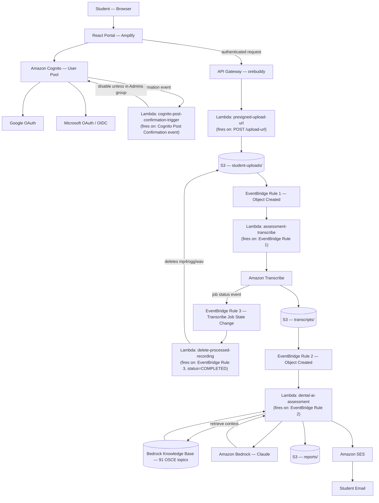
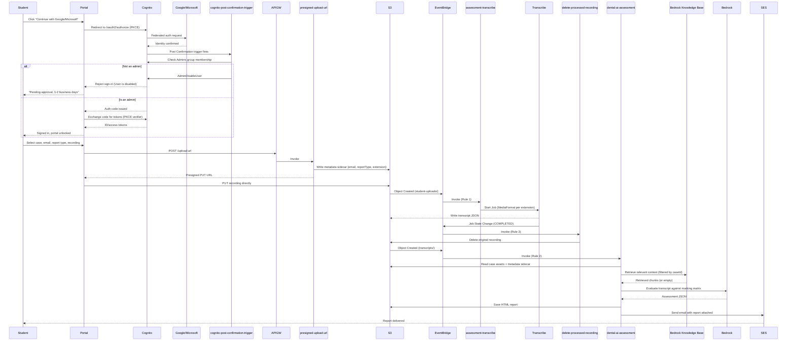

# Plan Ore Academy — AI Study Pal for ORE & LDS

An AI-powered assessment platform helping UK dental students practise
ORE and LDS exam-style clinical scenarios (OSCE/DTP stations). A
student records themselves responding to a case, and receives
examiner-style feedback — a score, strengths, and areas for
improvement — generated automatically against the case's official
marking matrix.

**Live portal:** https://planoreacademy.co.uk

---

## Table of Contents

- [What's Actually Live](#-whats-actually-live)
- [End-to-End Architecture](#-end-to-end-architecture)
- [Where Each Lambda Fires](#-where-each-lambda-fires)
- [Authentication & Registration (Cognito)](#-authentication--registration-cognito)
- [Sequence Diagram](#-sequence-diagram)
- [S3 Bucket Structure](#-s3-bucket-structure)
- [Case Configuration](#-case-configuration)
- [Retrieval-Augmented Generation (Bedrock Knowledge Base)](#-retrieval-augmented-generation-bedrock-knowledge-base)
- [Transcription Flow](#-transcription-flow)
- [Recording Cleanup Flow](#️-recording-cleanup-flow)
- [Assessment Flow](#-assessment-flow)
- [Lambda Functions Reference](#-lambda-functions-reference)
- [Report Generation](#-report-generation)
- [Email Delivery](#-email-delivery)
- [IAM Permissions](#-iam-permissions)
- [Adding a New Case](#-adding-a-new-case)
- [Deployment Guide](#-deployment-guide)
- [Reliability Notes](#-reliability-notes)
- [Deployment Gotchas](#-deployment-gotchas)
- [Known Gaps & Next Steps](#-known-gaps--next-steps)
- [Roadmap](#-roadmap)

---

## ✅ What's Actually Live

| Component | Status |
|---|---|
| React portal, deployed on AWS Amplify at planoreacademy.co.uk | ✅ Live |
| Google + Microsoft federated sign-in via Amazon Cognito | ✅ Live |
| Admin bypass (instant access, no approval wait) | ✅ Live |
| Manual student approval workflow | ✅ Live (console/CLI-based) |
| 10 working cases, each with full marking + Knowledge Base augmentation | ✅ Live |
| Fully automated EventBridge pipeline (upload → transcribe → cleanup → assess) | ✅ Live |
| MP4 / OGG / WAV recording support | ✅ Live |
| Automatic recording deletion post-transcription (T&C compliance) | ✅ Live |
| Bedrock Knowledge Base (RAG) — 91 pre-loaded OSCE reference topics | ✅ Live |
| Email delivery via Amazon SES, domain-authenticated (SPF/DKIM/DMARC) | ✅ Live |
| SES production access (beyond sandbox limits) | ❌ Requested, not yet approved |
| Server-side Cognito token verification on upload | ❌ Not yet built — see Known Gaps |
| In-portal admin approval UI | ❌ Not yet built — console/CLI only |
| PDF reports | ❌ Not built — HTML only |

---

## 🏗 End-to-End Architecture



---

## 📍 Where Each Lambda Fires

This is the quick-reference version of the diagram above — every Lambda
in this system is event-driven, never called directly by the frontend
except the presigned-URL request:

| Lambda | Triggered by | Trigger detail |
|---|---|---|
| `cognito-post-confirmation-trigger` | **Cognito** | Post Confirmation trigger — fires the moment a Google/Microsoft sign-in is confirmed |
| `presigned-upload-url` | **API Gateway** | `POST /upload-url` — the only Lambda the frontend calls directly |
| `assessment-transcribe` | **EventBridge Rule 1** | S3 `Object Created` under `student-uploads/` |
| `delete-processed-recording` | **EventBridge Rule 3** | Amazon Transcribe `Job State Change` event, `status: COMPLETED` |
| `dental-ai-assessment` | **EventBridge Rule 2** | S3 `Object Created`, wildcard `transcripts/*.json` |

Three of these five Lambdas fire from **EventBridge**, one fires from
**API Gateway**, and one fires from **Cognito's own trigger system** —
three genuinely different trigger mechanisms across the pipeline, each
chosen because it's the natural event source for that step.

---

## 🔐 Authentication & Registration (Cognito)

### Design decision — federated login only, no passwords

Students sign in exclusively via **Google or Microsoft** — there is no
native email/password sign-up path in this system at all. This is a
deliberate choice: a personal Gmail or Outlook account is
significantly harder to casually share between friends than a
throwaway portal password, which directly supports a per-seat pricing
model without students splitting the cost of one login.

Cognito's own self-registration feature is explicitly **disabled** —
federated sign-in still auto-creates a user record without it, and
disabling it removes any password-based account-creation path
entirely.

### Approval flow

1. Student clicks "Continue with Google" or "Continue with Microsoft"
   on the portal's own themed login screen (not Cognito's generic
   Hosted UI — the portal redirects straight to the provider's
   consent screen)
2. On successful sign-in, Cognito's **Post Confirmation** trigger
   (`cognito-post-confirmation-trigger`) fires
3. The trigger checks whether this account is a member of the
   **`Admins`** Cognito group:
   - **If yes** → nothing happens, the account stays enabled, instant
     access every time
   - **If no** → the account is immediately disabled via
     `AdminDisableUser`, and an optional email notification is sent
4. A disabled account attempting to sign in is rejected by Cognito
   itself (either at the `/oauth2/authorize` step or during token
   exchange, depending on timing) — the portal detects this specific
   rejection and shows a friendly "your access is pending approval,
   1-2 business days" screen rather than a generic error
5. An admin reviews pending accounts and runs `AdminEnableUser` (via
   CLI, or via a narrowly-scoped IAM console user — see below) — no
   automated identity verification is performed; the student's name
   (auto-populated from their Google/Microsoft profile) is the sole
   basis for the manual approval judgment, since no enrollment ID is
   collected

### Admin bypass — how "admin" actually works

"Admin" is entirely a matter of **Cognito group membership**, not tied
to any specific email address. The academy's own account is an admin
only because it was manually added to the `Admins` group — any other
account could be promoted the same way:

```bash
aws cognito-idp admin-add-user-to-group \
  --user-pool-id eu-west-2_DkCKtuhbh \
  --username <cognito-username> \
  --group-name Admins \
  --region eu-west-2

aws cognito-idp admin-enable-user \
  --user-pool-id eu-west-2_DkCKtuhbh \
  --username <cognito-username> \
  --region eu-west-2
```

### Delegated approval access, without full AWS access

Day-to-day approvals don't require the account owner's own
credentials. A narrowly-scoped IAM console user can be created with a
policy granting **only**:
```
cognito-idp:ListUsers
cognito-idp:AdminEnableUser
cognito-idp:AdminDisableUser
cognito-idp:AdminGetUser
```
scoped to the single User Pool ARN — nothing else in the AWS account
is reachable with this policy. That person reviews and approves
entirely through the Cognito console's **Users** tab (visible
Enabled/Disabled status, with an Enable button right in the UI).

### Known limitation — Microsoft personal vs. organizational accounts

Cognito's Microsoft OIDC provider is currently configured with an
issuer URL scoped specifically to **personal** Microsoft accounts
(Outlook/Hotmail), rather than Microsoft's generic multi-tenant
routing endpoint. This was a deliberate trade-off: the generic
`common` issuer caused a "bad id_token issuer" rejection for personal
accounts (Microsoft substitutes in a fixed real tenant ID for personal
accounts, which then fails Cognito's strict issuer match against the
literal word `common`). Fixing this for personal accounts means a
student with an **organizational** Microsoft 365 account (e.g.
university-issued) will likely now fail the same check in the
opposite direction. Supporting both simultaneously is a known,
not-yet-solved limitation — deferred as a deliberate choice, not an
oversight.

---

## 🔄 Sequence Diagram



---

## 📦 S3 Bucket Structure

```
planore-ai-tutor/

cases/
├── case1-amalgam-highspot/
│   ├── case-study.jpeg
│   ├── case-evaluation-matrix-extracted.txt
│   ├── reference-knowledge.json
│   └── prompt-template.txt          ← filename MUST be exactly this
│
├── case4-bleeding/
│   └── ... (same 4-file pattern)
│
└── caseN-.../                       ← same pattern for every case (10 live, more in progress)

student-uploads/
├── case4-bleeding/
│   ├── janedoe-1784980001.mp4       ← TRANSIENT — deleted after transcription
│   │                                   (or .ogg / .wav, format-agnostic)
│   └── janedoe-1784980001.metadata.json   ← { emailId, reportType, recordingExtension }

transcripts/
├── case4-bleeding/
│   └── janedoe-1784980001.json      ← Amazon Transcribe output, RETAINED

reports/
├── case4-bleeding/
│   └── janedoe-1784980001-report.html   ← RETAINED

knowledge-base-sources/
├── case1-amalgam-highspot.txt
├── case1-amalgam-highspot.txt.metadata.json   ← { metadataAttributes: { caseId: "..." } }
├── periodontitis.txt                ← pre-loaded OSCE topics not yet built as live cases
├── periodontitis.txt.metadata.json
└── ... (91 files total, one per OSCE topic)
```

The `knowledge-base-sources/` prefix is a separate, independent
structure from `cases/` — it's the raw material ingested into the
Bedrock Knowledge Base, not directly read by the assessment Lambda.

---

## 📋 Case Configuration

Each case is fully defined by four files in `cases/{caseId}/` — no
code changes are needed to add a new case:

| File | Purpose |
|---|---|
| `case-study.jpeg` **or** `case-study.txt` | The clinical scenario |
| `case-evaluation-matrix-extracted.txt` | The official marking rubric |
| `reference-knowledge.json` | Transcribe-format reference/model answer |
| `prompt-template.txt` | The full examiner prompt |

Every current `prompt-template.txt` includes, **by default, as a
standing convention for all future cases too**:

1. A deduplication rule (each feedback point appears in exactly one
   place — criteria feedback, strengths, areas for improvement, or
   final summary — never repeated)
2. A patient identification exclusion (never assess/comment on
   name/gender matching)
3. An `ADDITIONAL REFERENCE MATERIAL (if relevant)` section containing
   `{knowledge_context}` — see the RAG section below

---

## 🧠 Retrieval-Augmented Generation (Bedrock Knowledge Base)

### What it is

A Bedrock Knowledge Base (ID `C0WHNVEHRC`) built from **91 individual
reference files**, one per OSCE topic, sourced from a comprehensive
master training document. Each file has a `.metadata.json` sidecar
tagging it with a `caseId` attribute, enabling **filtered retrieval**
— a query for case4 only ever searches case4's own content, never
cross-contaminating with unrelated cases' material.

Only 10 of the 91 pre-loaded topics currently correspond to a live
case; the remaining 81 are inert until a matching live case is built,
at which point they become immediately useful with no re-ingestion
needed.

### How it's used

Every case's `prompt-template.txt` includes a `{knowledge_context}`
placeholder. In `dental-ai-assessment`, right before building the
prompt:

```python
knowledge_context = retrieve_knowledge_base_context(
    query_text=student_answer,
    case_id=case_id
)
```

This performs a `bedrock-agent-runtime.retrieve()` call, filtered by
the case's `caseId` metadata attribute. The retrieved chunks (or an
empty string, if nothing relevant is found or the Knowledge Base call
fails for any reason) are folded into the prompt. The prompt
explicitly instructs Claude to use this content **only where genuinely
relevant**, and to disregard it entirely if empty — this is additive
supplementary context, never a replacement for each case's own
dedicated marking matrix and reference answer, and a Knowledge Base
outage or empty result never blocks or degrades a case that doesn't
need it.

**Environment variable:** `KNOWLEDGE_BASE_ID` on `dental-ai-assessment`.
**IAM:** `bedrock:Retrieve` scoped to the Knowledge Base's ARN.

---

## 🎙 Transcription Flow

`assessment-transcribe`, triggered by **EventBridge Rule 1**:

```json
{
  "source": ["aws.s3"],
  "detail-type": ["Object Created"],
  "detail": {
    "bucket": { "name": ["planore-ai-tutor"] },
    "object": { "key": [{ "prefix": "student-uploads/" }] }
  }
}
```

Derives `caseId` and student name from the S3 key, and the correct
Amazon Transcribe `MediaFormat` from the file's actual extension
(`.mp4`, `.ogg`, or `.wav` — all three are supported end-to-end,
coordinated across this Lambda, the cleanup Lambda, and the frontend's
upload validation). Starts the job, output lands in `transcripts/`.

A DLQ (`eventbridge-transcribe-dlq`) is attached to this rule's
target.

---

## 🗑️ Recording Cleanup Flow

`delete-processed-recording`, triggered by **EventBridge Rule 3** —
listening to Amazon Transcribe's own job-status events, a genuinely
different event source from Rules 1 and 2:

```json
{
  "source": ["aws.transcribe"],
  "detail-type": ["Transcribe Job State Change"],
  "detail": { "TranscriptionJobStatus": ["COMPLETED"] }
}
```

- Fires only on `COMPLETED`, never `FAILED`/`IN_PROGRESS`
- Reconstructs the original recording's key from the Transcribe job
  name, trying each allowed extension (`mp4`/`ogg`/`wav`) via
  `head_object` until it finds the one that actually exists — since
  the job-status event doesn't carry the original extension
- Deletes only the recording — never the metadata sidecar or the
  transcript
- Runs independently of the Assessment Lambda — deletion happens the
  moment transcription completes, regardless of downstream scoring
  outcome

This is the mechanism that makes the platform's Terms & Conditions
promise — "recordings are deleted after transcription" — actually
true, not aspirational.

---

## 🩺 Assessment Flow

`dental-ai-assessment`, triggered by **EventBridge Rule 2**:

```json
{
  "source": ["aws.s3"],
  "detail-type": ["Object Created"],
  "detail": {
    "bucket": { "name": ["planore-ai-tutor"] },
    "object": { "key": [{ "wildcard": "transcripts/*.json" }] }
  }
}
```

1. Reads the case's four files from `cases/{caseId}/`
2. Reads the metadata sidecar (email, report type)
3. Runs a case-relevance pre-check — a separate, narrow Bedrock call
   that catches a transcript uploaded against the wrong case, before
   the expensive full-scoring call runs
4. Retrieves supplementary context from the Knowledge Base
5. Builds the full prompt and calls Bedrock (Claude)
6. Generates the HTML report (`detailed` or `basic`)
7. Saves the report to S3 and emails it via SES

Manual invocation (bypassing the portal/EventBridge) is fully
supported for testing:

```bash
aws lambda invoke \
  --function-name dental-ai-assessment \
  --payload '{"caseId":"case4-bleeding","student_json_key":"transcripts/case4-bleeding/student1.json","emailId":"academy@planore.co.uk","reportType":"basic"}' \
  --cli-binary-format raw-in-base64-out \
  response.json
```

---

## ⚙️ Lambda Functions Reference

| Lambda | Trigger | Role |
|---|---|---|
| `cognito-post-confirmation-trigger` | Cognito Post Confirmation | Disables new accounts unless already in the `Admins` group |
| `presigned-upload-url` | API Gateway `POST /upload-url` | Issues a scoped S3 PUT URL, writes the metadata sidecar, validates file extension |
| `assessment-transcribe` | EventBridge Rule 1 | Starts the Transcribe job with the correct MediaFormat |
| `delete-processed-recording` | EventBridge Rule 3 | Deletes the original recording once transcription completes |
| `dental-ai-assessment` | EventBridge Rule 2 | Runs the relevance check, Knowledge Base retrieval, Bedrock scoring, report generation, and email |

---

## 📄 Report Generation

The report structure is fully generic, iterating over whatever
`criteria`, `strengths`, `areas_for_improvement`, and
`confidence_assessment` fields Claude returns. `reportType` controls
which sections render:

| Section | `detailed` | `basic` |
|---|---|---|
| Score & grade | ✅ | ✅ |
| Criteria breakdown table | ✅ | ❌ |
| Confidence & delivery | ✅ | ❌ |
| Key strengths | ✅ | ✅ |
| Areas for improvement | ✅ | ✅ |
| Final summary | ✅ | ✅ |

A separate, short rejection-report template is used when the
case-relevance pre-check fails.

---

## 📧 Email Delivery

- **Service:** Amazon SES (`send_raw_email`), HTML report as an
  attachment
- **Domain authentication:** `planore.co.uk` is fully verified with
  SPF (merged into the domain's existing Google Workspace record —
  never a second, competing SPF record), DKIM (3 CNAME records), and
  DMARC — DNS is managed via Wix, despite the domain having been
  purchased through GoDaddy
- **Production access:** requested, not yet approved — SES sandbox
  limits still apply, meaning both sender and every recipient must be
  individually verified until this clears

---

## 🔑 IAM Permissions

**`cognito-post-confirmation-trigger`:**
- `cognito-idp:AdminListGroupsForUser`, `cognito-idp:AdminDisableUser`
  scoped to the User Pool ARN
- `ses:SendEmail` (optional approval notification)

**`dental-ai-assessment`:**
- `s3:GetObject`/`PutObject` on case/transcript/report/metadata
  prefixes
- `bedrock:InvokeModel`
- `bedrock:Retrieve` scoped to the Knowledge Base ARN
- `ses:SendRawEmail`

**`presigned-upload-url`:**
- `s3:PutObject` scoped to `student-uploads/*`

**`delete-processed-recording`:**
- `s3:DeleteObject`, `s3:GetObject` scoped to `student-uploads/*`
- `s3:ListBucket` scoped to `cases/*` and `student-uploads/*` prefixes

**Delegated approval IAM user** (for a non-owner reviewer):
- `cognito-idp:ListUsers`, `AdminEnableUser`, `AdminDisableUser`,
  `AdminGetUser` scoped to the single User Pool ARN — nothing else

---

## ➕ Adding a New Case

1. Create `cases/caseN-<slug>/` in S3
2. Upload `case-evaluation-matrix-extracted.txt`,
   `reference-knowledge.json`, and either `case-study.jpeg` or
   `case-study.txt`
3. Write `prompt-template.txt` — including the standard deduplication
   rule, patient-identification exclusion, and the
   `{knowledge_context}` placeholder by default
4. Add the case to `CASE_CATALOG` in
   `app/dental-ai-portal/src/config.js` and redeploy
5. If the case's topic matches one of the 91 pre-loaded Knowledge Base
   files, retrieval becomes useful immediately with no extra work

---

## 🚀 Deployment Guide

**Frontend (Amplify):**
- `amplify.yml` must use the wrapped monorepo format (app lives at
  `app/dental-ai-portal/`, not the repo root):
  ```yaml
  version: 1
  applications:
    - frontend:
        phases:
          preBuild:
            commands:
              - npm install
          build:
            commands:
              - npm run build
        artifacts:
          baseDirectory: dist
          files:
            - '**/*'
        cache:
          paths:
            - node_modules/**/*
      appRoot: app/dental-ai-portal
  ```

**Cognito setup, high level:**
1. Create the User Pool (Email as sign-in identifier, self-registration OFF)
2. Register OAuth apps in Google Cloud Console and Azure — publish the
   Google app to Production once basic-scopes-only (no formal
   verification needed for `openid email profile`)
3. Add both as federated identity providers in Cognito, enable them
   per App Client (a separate step from adding at the User Pool level)
4. Create the `Admins` group
5. Deploy `cognito-post-confirmation-trigger`, attach it via
   `update-user-pool --lambda-config` (verify via `describe-user-pool`
   — console UI attachment can silently fail to save)
6. Standardize every redirect/callback URL on the `www` subdomain
   consistently (not the bare root domain) if the domain uses
   forwarding rather than a true root-domain alias — bare vs. `www`
   are different origins for `sessionStorage`/PKCE purposes

**Lambda environment variables:**
- `dental-ai-assessment`: `BUCKET_NAME`, `MODEL_ID`, `REGION`,
  `SES_SENDER`, `DEFAULT_NOTIFY_EMAIL`, `DEFAULT_REPORT_TYPE`,
  `KNOWLEDGE_BASE_ID`
- `assessment-transcribe`: `INPUT_BUCKET`, `OUTPUT_BUCKET`,
  `INPUT_PREFIX`, `OUTPUT_PREFIX`, `REGION`
- `presigned-upload-url`: `BUCKET_NAME`, `REGION`
- `delete-processed-recording`: `BUCKET_NAME`, `REGION`, `INPUT_PREFIX`
- `cognito-post-confirmation-trigger`: `REGION`, `ADMIN_GROUP_NAME`,
  `ADMIN_NOTIFY_EMAIL` (optional), `SES_SENDER` (optional)

---

## 🔁 Reliability Notes

**Recurring lesson, hit repeatedly across this project on two
different AWS services (EventBridge and Cognito):** a trigger/rule
attachment made via the console UI can silently fail to save. Always
verify with a direct read-back CLI command (`describe-user-pool`,
`list-rules`, `get-policy`) before assuming a console click actually
took effect.

**Also recurring:** creating an EventBridge rule/target, or a Cognito
trigger, **before** the target Lambda is actually deployed fails
cleanly at the permission-grant step. Always deploy and directly test
a new Lambda before wiring any trigger to it.

DLQs are attached to EventBridge rule targets to capture failed
invocations for debugging.

---

## 🛠 Deployment Gotchas

1. **Amplify monorepo spec** requires the wrapped `applications:`
   format — a flat spec fails with `Monorepo spec provided without
   "applications" key`.
2. **`npm ci` requires a committed `package-lock.json`.**
3. **CORS for a presigned-URL flow needs configuring in two places** —
   API Gateway's own CORS covers the `POST /upload-url` call; the
   actual upload is a direct browser-to-S3 PUT requiring its own CORS
   policy on the bucket.
4. **Cross-origin `sessionStorage` breaks PKCE flows silently.** If a
   domain is only reachable via a forwarding redirect (e.g.
   `example.com` → `www.example.com` via registrar-level forwarding,
   not a true DNS alias), the bare and `www` versions are different
   origins for `sessionStorage`. A PKCE verifier written on one and
   read on the other is always empty, causing sign-in to silently fail
   with no useful error. Fix: standardize every OAuth
   redirect/callback URL on the one real, non-forwarded serving
   origin.
5. **Google requires an explicit `select_account` prompt parameter**
   to reliably show its account chooser on every attempt; Microsoft
   requires it even more — without it, Microsoft silently reuses
   whatever account is already active in the browser with no way to
   pick a different one.
6. **`window.location.href` navigation + browser back-forward cache
   (bfcache) can leave React state stuck.** If a component sets
   loading state before navigating away (e.g. disabling a button
   during an OAuth redirect), and the browser restores the page from
   bfcache on a Back navigation rather than a fresh load, that state
   comes back stuck with nothing to reset it. Fix: listen for the
   `pageshow` event and check `event.persisted`.
7. **Native `<select>` dropdown styling is inconsistently supported.**
   Requires `color-scheme: dark` plus explicit per-`<option>`
   background/color — a real platform limitation. (This project moved
   away from a native select to a custom searchable combobox once the
   case count grew, sidestepping this entirely.)

---

## 🚧 Known Gaps & Next Steps

1. **No server-side Cognito token verification on upload.** The React
   login gate is a real UX boundary, but `presigned-upload-url`
   doesn't yet independently verify the access token's signature
   (against Cognito's JWKS), expiry, `token_use`, or `client_id`
   before accepting a request. A disabled account is blocked from
   *signing in*, but a stale or crafted token calling the API directly
   isn't yet rejected server-side.
2. **No in-portal admin approval UI.** Reviewing and approving pending
   students is entirely console/CLI-based today.
3. **Microsoft personal vs. organizational accounts** — see the
   Authentication section above; currently only personal Outlook
   accounts work correctly.
4. **SES production access** — still pending approval; sandbox limits
   apply until cleared.
5. **Bounce/complaint SNS handling** — not yet built; recommended
   before submitting for SES production access.
6. **Single point of failure on the `Admins` group** — only one
   account is currently promoted; worth adding a backup admin.

---

## 🗺 Roadmap

**Phase 1 — Complete ✅**
- Portal, upload, transcription, assessment, email, fully automated
  pipeline, recording cleanup, MP4/OGG/WAV support

**Phase 2 — In progress**
- Cognito federated authentication and approval workflow (mostly
  live — see Known Gaps)
- Bedrock Knowledge Base / RAG (live, 91 topics pre-loaded)
- Scaling toward 300 cases (10 live)
- In-portal admin dashboard
- Server-side token verification hardening

**Phase 3 — Planned**
- Live AI Study Buddy (voice-only roleplay patient, real-time loop)
