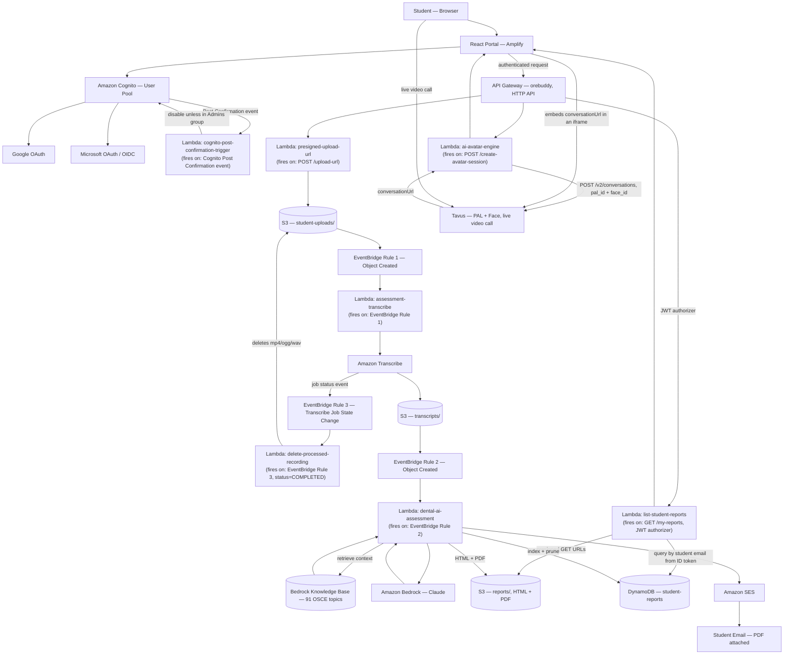
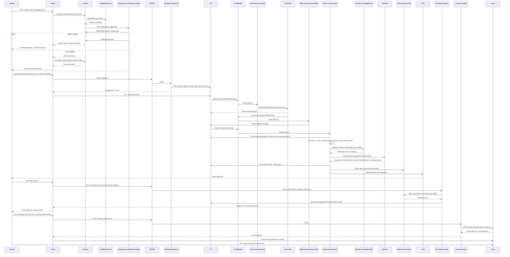

# Plan Ore Academy — AI Study Pal for ORE & LDS

An AI-powered assessment platform helping UK dental students practise
ORE and LDS exam-style clinical scenarios across two station formats —
**OSCE** (structured role-play consultation) and **SCR** (Structured
Clinical Reasoning discussion), with **DTP** planned. A student
records themselves responding to a case, and receives examiner-style
feedback — a score, strengths, and areas for improvement — generated
automatically against the case's official marking matrix, delivered
by email as a PDF and viewable/printable anytime from the portal's
"My Reports" page.

**Live portal:** https://planoreacademy.co.uk

**Product direction note:** this React portal is now designated an
**admin-only testing tool**, covering both the offline audio-recording
upload flow (OSCE/SCR/DTP) and the AI-avatar-based practice engine
below. A separate, dedicated portal for real Mock Exam simulation is
planned as its own future build — this repo is not that portal.

---

## Table of Contents

- [What's Actually Live](#-whats-actually-live)
- [End-to-End Architecture](#-end-to-end-architecture)
- [Where Each Lambda Fires](#-where-each-lambda-fires)
- [Authentication & Registration (Cognito)](#-authentication--registration-cognito)
- [Sequence Diagram](#-sequence-diagram)
- [S3 Bucket Structure](#-s3-bucket-structure)
- [Case Configuration](#-case-configuration)
- [Assessment Types — OSCE vs SCR](#-assessment-types--osce-vs-scr)
- [Retrieval-Augmented Generation (Bedrock Knowledge Base)](#-retrieval-augmented-generation-bedrock-knowledge-base)
- [Transcription Flow](#-transcription-flow)
- [Recording Cleanup Flow](#️-recording-cleanup-flow)
- [Assessment Flow](#-assessment-flow)
- [Lambda Functions Reference](#-lambda-functions-reference)
- [Report Generation](#-report-generation)
- [PDF Reports & Retention](#-pdf-reports--retention)
- [My Reports (Student Report History)](#-my-reports-student-report-history)
- [Email Delivery](#-email-delivery)
- [IAM Permissions](#-iam-permissions)
- [AI Avatar Engine — Tavus Integration (OSCE & SCR)](#-ai-avatar-engine--tavus-integration-osce--scr)
- [Adding a New Case](#-adding-a-new-case)
- [Deployment Guide](#-deployment-guide)
- [Reliability Notes](#-reliability-notes)
- [Deployment Gotchas](#-deployment-gotchas)
- [Known Gaps & Next Steps](#-known-gaps--next-steps)
- [Roadmap](#-roadmap)

---

## ✅ What's Actually Live

| Component | Status |
|---|---|
| React portal, deployed on AWS Amplify at planoreacademy.co.uk | ✅ Live |
| Google + Microsoft federated sign-in via Amazon Cognito | ✅ Live |
| Admin bypass (instant access, no approval wait) | ✅ Live |
| Manual student approval workflow | ✅ Live (console/CLI-based) |
| **87 OSCE cases authored (Cases 1–87)**, each with full marking; Knowledge Base augmentation applies wherever a case's topic matches one of the 91 pre-loaded KB files — see [Known Gaps](#-known-gaps--next-steps) re: verifying that mapping at this scale | ⚠️ Authored & packaged — confirm S3 upload + `config.js` deploy status |
| **SCR station type — 44 cases authored (Cases 1–44)** | ⚠️ Authored & packaged — confirm S3 upload + `config.js` deploy status |
| Fully automated EventBridge pipeline (upload → transcribe → cleanup → assess) | ✅ Live |
| MP4 / OGG / WAV recording support | ✅ Live |
| Automatic recording deletion post-transcription (T&C compliance) | ✅ Live |
| Bedrock Knowledge Base (RAG) — 91 pre-loaded OSCE reference topics | ✅ Live |
| Multi-image case studies (SCR) alongside single-image/text-only (OSCE) | ✅ Live |
| SCR recording time gate — flagged 10-12 min, hard reject beyond 12 min | ✅ Live |
| PDF report generation (ReportLab) attached to email | ✅ Live |
| Per-student report history ("My Reports") with view/print + PDF download | ✅ Live |
| Report retention — last 3 months or 50 reports, whichever is fewer | ✅ Live |
| Email delivery via Amazon SES, domain-authenticated (SPF/DKIM/DMARC) | ✅ Live |
| SES production access (beyond sandbox limits) | ✅ Approved |
| **AI Avatar tab — real live Tavus call embedded (case3-avulsed-tooth only)** | ✅ Live for 1 case |
| **`ai-avatar-engine` Lambda — deployed, wired to `POST /create-avatar-session`, IAM confirmed** | ✅ Live |
| **Tavus PAL created, tone-calibrated and facial-expression-calibrated** (`pal_id: pc08ef5b4df3`) | ✅ Live (1 PAL, 1 case) |
| **AI Avatar Engine scaled to all 87 OSCE + 44 SCR cases** | ❌ Not yet built — see [AI Avatar Engine](#-ai-avatar-engine--tavus-integration-osce--scr) |
| Server-side Cognito token verification on upload | ❌ Not yet built — see Known Gaps |
| In-portal admin approval UI | ❌ Not yet built — console/CLI only |
| DTP station type | ❌ Planned, not yet built |

> **Note on the two ⚠️ rows above:** case content for OSCE 1–87 and SCR
> 1–44 has been authored, validated (JSON schema, domain/criteria
> cross-checks, internal consistency between the marking matrix,
> reference answer, and prompt template), and packaged into the
> `cases/{caseId}/` 5-file structure this README documents. Whether
> every batch has actually been uploaded to S3 and added to
> `CASE_CATALOG` in `config.js` should be confirmed against the live
> bucket and portal before treating the full range as production-ready
> — update this table with the real confirmed count once verified.

---

## 🏗 End-to-End Architecture



---

## 📍 Where Each Lambda Fires

This is the quick-reference version of the diagram above — every Lambda
in this system is event-driven, never called directly by the frontend
except the three API Gateway routes:

| Lambda | Triggered by | Trigger detail |
|---|---|---|
| `cognito-post-confirmation-trigger` | **Cognito** | Post Confirmation trigger — fires the moment a Google/Microsoft sign-in is confirmed |
| `presigned-upload-url` | **API Gateway** | `POST /upload-url` — no auth required, the only unauthenticated call the frontend makes |
| `list-student-reports` | **API Gateway** | `GET /my-reports` — behind a Cognito JWT authorizer; identity comes from the verified ID token, never the request itself |
| `assessment-transcribe` | **EventBridge Rule 1** | S3 `Object Created` under `student-uploads/` |
| `delete-processed-recording` | **EventBridge Rule 3** | Amazon Transcribe `Job State Change` event, `status: COMPLETED` |
| `dental-ai-assessment` | **EventBridge Rule 2** | S3 `Object Created`, wildcard `transcripts/*.json` |
| `ai-avatar-engine` | **API Gateway** | `POST /create-avatar-session` — no auth required yet (same known gap as `presigned-upload-url` — see Known Gaps); creates a live Tavus conversation |

Five genuinely different trigger mechanisms across the pipeline: three
Lambdas fire from **EventBridge**, three fire from **API Gateway** (two
open, one JWT-authorized), and one fires from **Cognito's own trigger
system** — each chosen because it's the natural event source for that
step.

**Important — API Gateway is an HTTP API (v2), not a REST API.**
This affects every Lambda behind it: authorizer claims land at
`event.requestContext.authorizer.jwt.claims` (not
`event.requestContext.authorizer.claims`, which is the REST API/classic
Cognito-authorizer shape), and the HTTP method for handling `OPTIONS`
must be read from `event.requestContext.http.method` (not
`event.httpMethod`). Get this wrong and the Lambda still deploys and
"looks" fine — it just silently never matches the branch you wrote,
which is exactly what happened once already with `list-student-reports`
before being caught and fixed. `ai-avatar-engine` was written against
this same HTTP API v2 shape from the start.

---

## 🔐 Authentication & Registration (Cognito)

### Design decision — federated login only, no passwords

Students sign in exclusively via **Google or Microsoft** — there is no
native email/password sign-up path in this system at all. This is a
deliberate choice: a personal Gmail or Outlook account is
significantly harder to casually share between friends than a
throwaway portal password, which directly supports a per-seat pricing
model without students splitting the cost of one login.

Cognito's own self-registration feature is explicitly **disabled** —
federated sign-in still auto-creates a user record without it, and
disabling it removes any password-based account-creation path
entirely.

### Approval flow

1. Student clicks "Continue with Google" or "Continue with Microsoft"
   on the portal's own themed login screen (not Cognito's generic
   Hosted UI — the portal redirects straight to the provider's
   consent screen)
2. On successful sign-in, Cognito's **Post Confirmation** trigger
   (`cognito-post-confirmation-trigger`) fires
3. The trigger checks whether this account is a member of the
   **`Admins`** Cognito group:
   - **If yes** → nothing happens, the account stays enabled, instant
     access every time
   - **If no** → the account is immediately disabled via
     `AdminDisableUser`, and an optional email notification is sent
4. A disabled account attempting to sign in is rejected by Cognito
   itself (either at the `/oauth2/authorize` step or during token
   exchange, depending on timing) — the portal detects this specific
   rejection and shows a friendly "your access is pending approval,
   1-2 business days" screen rather than a generic error
5. An admin reviews pending accounts and runs `AdminEnableUser` (via
   CLI, or via a narrowly-scoped IAM console user — see below) — no
   automated identity verification is performed; the student's name
   (auto-populated from their Google/Microsoft profile) is the sole
   basis for the manual approval judgment, since no enrollment ID is
   collected

### Admin bypass — how "admin" actually works

"Admin" is entirely a matter of **Cognito group membership**, not tied
to any specific email address. The academy's own account is an admin
only because it was manually added to the `Admins` group — any other
account could be promoted the same way:

```bash
aws cognito-idp admin-add-user-to-group \
  --user-pool-id eu-west-2_DkCKtuhbh \
  --username <cognito-username> \
  --group-name Admins \
  --region eu-west-2

aws cognito-idp admin-enable-user \
  --user-pool-id eu-west-2_DkCKtuhbh \
  --username <cognito-username> \
  --region eu-west-2
```

### Delegated approval access, without full AWS access

Day-to-day approvals don't require the account owner's own
credentials. A narrowly-scoped IAM console user can be created with a
policy granting **only**:
```
cognito-idp:ListUsers
cognito-idp:AdminEnableUser
cognito-idp:AdminDisableUser
cognito-idp:AdminGetUser
```
scoped to the single User Pool ARN — nothing else in the AWS account
is reachable with this policy. That person reviews and approves
entirely through the Cognito console's **Users** tab (visible
Enabled/Disabled status, with an Enable button right in the UI).

### Known limitation — Microsoft personal vs. organizational accounts

Cognito's Microsoft OIDC provider is currently configured with an
issuer URL scoped specifically to **personal** Microsoft accounts
(Outlook/Hotmail), rather than Microsoft's generic multi-tenant
routing endpoint. This was a deliberate trade-off: the generic
`common` issuer caused a "bad id_token issuer" rejection for personal
accounts (Microsoft substitutes in a fixed real tenant ID for personal
accounts, which then fails Cognito's strict issuer match against the
literal word `common`). Fixing this for personal accounts means a
student with an **organizational** Microsoft 365 account (e.g.
university-issued) will likely now fail the same check in the
opposite direction. Supporting both simultaneously is a known,
not-yet-solved limitation — deferred as a deliberate choice, not an
oversight.

### JWT authorizer for `/my-reports` (HTTP API — different from REST API)

HTTP APIs don't have the REST API's dedicated "Cognito User Pool
authorizer" type. Instead, a **JWT authorizer** is created pointed at
Cognito's own OIDC issuer:

- Issuer: `https://cognito-idp.eu-west-2.amazonaws.com/eu-west-2_DkCKtuhbh`
- Audience: the App Client ID (`qu9cshab6t3rodq4t63jvtapl`)
- Identity source: `$request.header.Authorization` (default)

The frontend must send the **ID token**, not the access token —
Cognito access tokens don't carry an `email` claim, only ID tokens do
— and must send it as `Bearer <token>`, not the raw token string; the
JWT authorizer silently rejects anything not in that exact format.

---

## 🔄 Sequence Diagram



---

## 📦 S3 Bucket Structure

```
planore-ai-tutor/

cases/
├── case1-amalgam-highspot/          ← OSCE — image or text case study
│   ├── case-study.jpeg
│   ├── case-evaluation-matrix-extracted.txt
│   ├── reference-knowledge.json
│   └── prompt-template.txt          ← filename MUST be exactly this
│
├── case4-bleeding/
│   └── ... (same 4-file OSCE pattern)
│
├── case1-scr-dental-trauma/         ← SCR — text + multiple images
│   ├── case-study.txt
│   ├── case-study-images/           ← any number, sorted filenames (01-, 02-...)
│   │   ├── 01-discoloration-reference.jpeg
│   │   ├── 02-periapical-xray.jpeg
│   │   └── 03-sinus-tract-photo.jpeg
│   ├── case-evaluation-matrix-extracted.txt   ← 4 domains, GDC codes + definitions
│   ├── reference-knowledge.json     ← Transcribe format — see note below
│   ├── prompt-template.txt          ← domain scoring 1-4 + code_glossary instruction
│   └── assessment-type.txt          ← contents: "SCR" (absence defaults to "OSCE")
│
└── caseN-.../                       ← same pattern for every case
                                         (87 OSCE + 44 SCR authored — see
                                         What's Actually Live for deploy status)

student-uploads/
├── case4-bleeding/
│   ├── janedoe-1784980001.mp4       ← TRANSIENT — deleted after transcription
│   │                                   (or .ogg / .wav, format-agnostic)
│   └── janedoe-1784980001.metadata.json   ← { emailId, reportType, recordingExtension }

transcripts/
├── case4-bleeding/
│   └── janedoe-1784980001.json      ← Amazon Transcribe output, RETAINED

reports/
├── case4-bleeding/
│   ├── janedoe-1784980001-report.html   ← RETAINED — portal view/print source
│   └── janedoe-1784980001-report.pdf    ← RETAINED — email attachment + download

knowledge-base-sources/
├── case1-amalgam-highspot.txt
├── case1-amalgam-highspot.txt.metadata.json   ← { metadataAttributes: { caseId: "..." } }
├── periodontitis.txt                ← pre-loaded OSCE topics not yet built as live cases
├── periodontitis.txt.metadata.json
└── ... (91 files total, one per OSCE topic)
```

> **`reference-knowledge.json` schema — required, not optional.**
> Every `reference-knowledge.json`, OSCE or SCR, must be a full Amazon
> Transcribe-shaped JSON object:
> `{ "jobName", "accountId", "status": "COMPLETED", "results": { "transcripts": [ { "transcript": "<the actual reference content, as a single string>" } ] } }`.
> The reference content itself — a spoken monologue for SCR, a scripted
> dialogue for OSCE — lives **inside** that `transcript` string. A file
> missing the top-level `results` key deploys and looks fine, but
> `dental-ai-assessment` throws `KeyError: 'results'` the first time a
> student submits against that case — see
> [Reliability Notes](#-reliability-notes) for how this was hit and
> fixed on a batch of SCR cases.

The `knowledge-base-sources/` prefix is a separate, independent
structure from `cases/` — it's the raw material ingested into the
Bedrock Knowledge Base, not directly read by the assessment Lambda.
Tavus's own Knowledge Base (used by the AI Avatar Engine) is a
**separate, third store** again — see
[AI Avatar Engine](#-ai-avatar-engine--tavus-integration-osce--scr) —
not to be confused with either of the above.

**DynamoDB — `student-reports` table** (not S3, but the index over
everything in `reports/`):

| Attribute | Role |
|---|---|
| `emailId` (String) | Partition key — student's email, lowercased |
| `reportTimestamp` (String, ISO8601) | Sort key |
| `caseId`, `studentFilePrefix`, `htmlKey`, `pdfKey`, `assessmentType` | Item attributes |

This exists because `reports/{caseId}/{student}.*` is keyed by case,
not by student — there's no way to answer "this student's last 50
reports across every case they've done" from S3 keys alone.

---

## 📋 Case Configuration

Each case is fully defined by files in `cases/{caseId}/` — no code
changes are needed to add a new case of either type:

| File | Purpose |
|---|---|
| `case-study.jpeg` **or** `case-study.txt`, optionally **plus** `case-study-images/` | The clinical scenario. OSCE cases use exactly one of jpeg/txt; SCR cases typically use text **and** a folder of images together |
| `case-evaluation-matrix-extracted.txt` | The official marking rubric — per-question for OSCE, per-domain (with GDC code + definition) for SCR |
| `reference-knowledge.json` | Full Transcribe-format JSON (`results.transcripts[0].transcript`) — the reference content inside is a spoken monologue for SCR, a scripted dialogue for OSCE. See the schema note in [S3 Bucket Structure](#-s3-bucket-structure) — this is a hard requirement, not a style convention |
| `prompt-template.txt` | The full examiner prompt |
| `assessment-type.txt` *(optional)* | Contents `SCR` or `OSCE` — absence defaults to `OSCE`, so none of the original 10 cases needed retrofitting |

Every current `prompt-template.txt` includes, **by default, as a
standing convention for all future cases too**:

1. A deduplication rule (each feedback point appears in exactly one
   place — criteria feedback, strengths, areas for improvement, or
   final summary — never repeated)
2. A patient identification exclusion (never assess/comment on
   name/gender matching)
3. An `ADDITIONAL REFERENCE MATERIAL (if relevant)` section containing
   `{knowledge_context}` — see the RAG section below

**Confidence-score calibration note:** the `confidence_assessment`
instruction needs an explicit 0-100 rubric with anchors (see SCR's
`prompt-template.txt` for the current wording) — without one, Claude
has nothing to calibrate against and can produce wildly miscalibrated
scores (observed: 6/100 for a transcript whose own written feedback
described adequate, if hesitant, performance). This fix has only been
applied to the SCR case's template so far; the original 10 OSCE
templates carry the same unanchored phrasing and haven't been
retrofitted yet — see Known Gaps.

---

## 🧩 Assessment Types — OSCE vs SCR

Two station formats are live, sharing one pipeline with no duplicated
infrastructure — see [Reliability Notes](#-reliability-notes) for why
a fully separate pipeline per type was deliberately rejected.

| | **OSCE** | **SCR** |
|---|---|---|
| Format | Structured role-play consultation with a simulated patient/actor | Spoken clinical-reasoning discussion, examiner-style |
| Case study | Single image **or** text | Text **plus** any number of images |
| Marking unit | Per-question criteria | 4 fixed domains, each scored 1-4 |
| Marking source | Free-form criteria list | GDC Safe Practitioner Framework codes, with official definitions baked into the marking matrix |
| Time limit | None enforced | Flagged (not rejected) 10-12 min; hard-rejected beyond 12 min |
| Report includes | Criteria table, confidence, strengths/improvements | Domain table, case summary, per-domain feedback, confidence, **GDC code glossary appendix** |

### How a case declares its type

`cases/{caseId}/assessment-type.txt` — a single-line file containing
`SCR`. If absent, `dental-ai-assessment` defaults to `OSCE`. `case_id`
itself is treated as a fully opaque string everywhere else in the
pipeline (presigned URL, Transcribe job naming, cleanup Lambda) — none
of those Lambdas needed any change to support SCR, since they never
parse `case_id`'s internal structure. Convention only, not enforced by
code: prefix new SCR case IDs like `case1-scr-dental-trauma` for
human readability and to avoid future collisions with OSCE case IDs.

### The GDC code glossary

SCR's `prompt-template.txt` instructs Claude to return a
`code_glossary` array using **only** the definitions supplied in that
case's own marking matrix — never from Claude's own general knowledge
of the framework, since exact regulatory wording matters and
shouldn't be paraphrased or hallucinated. The marking matrix must
therefore contain the real definitions, sourced from the official GDC
document, *The Safe Practitioner: A framework of behaviours and
outcomes for dental professional education* (Dentist version,
November 2023):
https://www.gdc-uk.org/docs/default-source/education-and-cpd/safe-practitoner/spf-dentist.pdf

Note: a meaningful share of the SCR source material used for Cases
27–44 is drawn from real, anonymised candidate exam recalls rather
than the GDC framework document directly, and several of those recall
documents don't cite Safe Practitioner C/I/P/S codes per question at
all — some instead reference the GDC's separate *Standards for the
Dental Team* numbered principles. Where a case's own source material
doesn't supply Safe Practitioner codes, none have been invented to
fill the gap; the `code_glossary` for those cases will legitimately be
sparser or empty for some domains. This is expected, not a data
quality issue.

### Multi-image case studies

`load_case_images()` in `dental-ai-assessment` loads every file under
`cases/{caseId}/case-study-images/` (sorted by filename — use
`01-`, `02-`... prefixes for predictable ordering), falling back to
the legacy single `case-study.jpeg` only if that folder is empty. Case
study **text and images are now loaded unconditionally and
independently** (not either/or as before) — an OSCE case with only
`case-study.jpeg` or only `case-study.txt` behaves identically to
before this change; only a case with **both** gets the new combined
behavior.

### SCR timing gate

```python
MAX_SCR_RECORDING_SECONDS = 720   # 12 min — hard reject
SCR_IDEAL_MAX_SECONDS     = 600   # 10 min — soft flag only
```

Duration is read from the student's own Transcribe JSON — specifically
the `end_time` of the last item in `results.items[]`, a field Transcribe
already returns but which wasn't being read before this feature.
Beyond the hard limit, a dedicated rejection report is generated (no
scoring call is made, saving a Bedrock invocation) and the report is
**not** indexed in `student-reports` — a rejection never counts against
a student's retention slots. Between 10 and 12 minutes, scoring proceeds
normally with an advisory banner in the report; this is gated `if
assessment_type == "SCR"` only, so OSCE cases are entirely unaffected.

---

## 🧠 Retrieval-Augmented Generation (Bedrock Knowledge Base)

### What it is

A Bedrock Knowledge Base (ID `C0WHNVEHRC`) built from **91 individual
reference files**, one per OSCE topic, sourced from a comprehensive
master training document. Each file has a `.metadata.json` sidecar
tagging it with a `caseId` attribute, enabling **filtered retrieval**
— a query for case4 only ever searches case4's own content, never
cross-contaminating with unrelated cases' material.

At original scale (10 live OSCE cases), only 10 of the 91 pre-loaded
topics corresponded to a live case, with the remaining 81 inert until
a matching case existed. With OSCE now authored up to Case 87, the
actual topic-to-case correspondence needs re-checking — it's likely
significantly higher than 10/91 now, but this hasn't been directly
verified against the current `knowledge-base-sources/` file list (see
Known Gaps). The Knowledge Base currently only covers OSCE topics —
SCR cases retrieve nothing (an empty string, handled gracefully) until
SCR topics are added.

### How it's used

Every case's `prompt-template.txt` includes a `{knowledge_context}`
placeholder. In `dental-ai-assessment`, right before building the
prompt:

```python
knowledge_context = retrieve_knowledge_base_context(
    query_text=student_answer,
    case_id=case_id
)
```

This performs a `bedrock-agent-runtime.retrieve()` call, filtered by
the case's `caseId` metadata attribute. The retrieved chunks (or an
empty string, if nothing relevant is found or the Knowledge Base call
fails for any reason) are folded into the prompt. The prompt
explicitly instructs Claude to use this content **only where genuinely
relevant**, and to disregard it entirely if empty — this is additive
supplementary context, never a replacement for each case's own
dedicated marking matrix and reference answer, and a Knowledge Base
outage or empty result never blocks or degrades a case that doesn't
need it.

**Environment variable:** `KNOWLEDGE_BASE_ID` on `dental-ai-assessment`.
**IAM:** `bedrock:Retrieve` scoped to the Knowledge Base's ARN.

---

## 🎙 Transcription Flow

`assessment-transcribe`, triggered by **EventBridge Rule 1**:

```json
{
  "source": ["aws.s3"],
  "detail-type": ["Object Created"],
  "detail": {
    "bucket": { "name": ["planore-ai-tutor"] },
    "object": { "key": [{ "prefix": "student-uploads/" }] }
  }
}
```

Derives `caseId` and student name from the S3 key, and the correct
Amazon Transcribe `MediaFormat` from the file's actual extension
(`.mp4`, `.ogg`, or `.wav` — all three are supported end-to-end,
coordinated across this Lambda, the cleanup Lambda, and the frontend's
upload validation). Starts the job, output lands in `transcripts/`.
Unchanged by SCR — Transcribe's own output already includes per-item
timing data (`results.items[].end_time`), which `dental-ai-assessment`
now reads for the SCR duration gate without any change needed here.

A DLQ (`eventbridge-transcribe-dlq`) is attached to this rule's
target.

---

## 🗑️ Recording Cleanup Flow

`delete-processed-recording`, triggered by **EventBridge Rule 3** —
listening to Amazon Transcribe's own job-status events, a genuinely
different event source from Rules 1 and 2:

```json
{
  "source": ["aws.transcribe"],
  "detail-type": ["Transcribe Job State Change"],
  "detail": { "TranscriptionJobStatus": ["COMPLETED"] }
}
```

- Fires only on `COMPLETED`, never `FAILED`/`IN_PROGRESS`
- Reconstructs the original recording's key from the Transcribe job
  name, trying each allowed extension (`mp4`/`ogg`/`wav`) via
  `head_object` until it finds the one that actually exists — since
  the job-status event doesn't carry the original extension
- Deletes only the recording — never the metadata sidecar or the
  transcript
- Runs independently of the Assessment Lambda — deletion happens the
  moment transcription completes, regardless of downstream scoring
  outcome

This is the mechanism that makes the platform's Terms & Conditions
promise — "recordings are deleted after transcription" — actually
true, not aspirational.

---

## 🩺 Assessment Flow

`dental-ai-assessment`, triggered by **EventBridge Rule 2**:

```json
{
  "source": ["aws.s3"],
  "detail-type": ["Object Created"],
  "detail": {
    "bucket": { "name": ["planore-ai-tutor"] },
    "object": { "key": [{ "wildcard": "transcripts/*.json" }] }
  }
}
```

1. Reads `assessment-type.txt` (defaults to `OSCE` if absent)
2. Reads the case's files from `cases/{caseId}/` — text and images
   loaded independently and unconditionally
3. Reads the metadata sidecar (email, report type)
4. **SCR only:** checks recording duration — hard reject beyond 12
   min, flag (not reject) beyond 10 min
5. Runs a case-relevance pre-check — a separate, narrow Bedrock call
   that catches a transcript uploaded against the wrong case, before
   the expensive full-scoring call runs
6. Retrieves supplementary context from the Knowledge Base
7. Builds the full prompt and calls Bedrock (Claude)
8. Generates the HTML report **and** a PDF (`generate_html_report`/
   `generate_html_report_scr` plus `generate_pdf_bytes`/
   `generate_pdf_bytes_scr`, branched on assessment type)
9. Saves both to S3, emails the PDF via SES
10. Indexes the report in `student-reports` and prunes anything
    beyond the retention rule (skipped entirely for rejections — a
    mismatched case or an over-time SCR recording never reaches this
    step)

Manual invocation (bypassing the portal/EventBridge) is fully
supported for testing:

```bash
aws lambda invoke \
  --function-name dental-ai-assessment \
  --payload '{"caseId":"case4-bleeding","student_json_key":"transcripts/case4-bleeding/student1.json","emailId":"academy@planore.co.uk","reportType":"basic"}' \
  --cli-binary-format raw-in-base64-out \
  response.json
```

---

## ⚙️ Lambda Functions Reference

| Lambda | Trigger | Role |
|---|---|---|
| `cognito-post-confirmation-trigger` | Cognito Post Confirmation | Disables new accounts unless already in the `Admins` group |
| `presigned-upload-url` | API Gateway `POST /upload-url` | Issues a scoped S3 PUT URL, writes the metadata sidecar, validates file extension |
| `assessment-transcribe` | EventBridge Rule 1 | Starts the Transcribe job with the correct MediaFormat |
| `delete-processed-recording` | EventBridge Rule 3 | Deletes the original recording once transcription completes |
| `dental-ai-assessment` | EventBridge Rule 2 | Runs the relevance check, timing gate (SCR), Knowledge Base retrieval, Bedrock scoring, HTML+PDF report generation, DynamoDB indexing, and email |
| `list-student-reports` | API Gateway `GET /my-reports` (JWT authorizer) | Queries `student-reports` for the signed-in student's own email, returns presigned view/download URLs |
| `ai-avatar-engine` | API Gateway `POST /create-avatar-session` | Reads `TAVUS_API_KEY` from an environment variable, calls Tavus's `POST /v2/conversations` with `pal_id`/`face_id`, returns `conversationUrl`/`conversationId` |

---

## 📄 Report Generation

The report structure is fully generic for OSCE, iterating over
whatever `criteria`, `strengths`, `areas_for_improvement`, and
`confidence_assessment` fields Claude returns. `reportType` controls
which sections render:

| Section | `detailed` | `basic` |
|---|---|---|
| Score & grade | ✅ | ✅ |
| Criteria breakdown table | ✅ | ❌ |
| Confidence & delivery | ✅ | ❌ |
| Key strengths | ✅ | ✅ |
| Areas for improvement | ✅ | ✅ |
| Final summary | ✅ | ✅ |

SCR reports (`generate_html_report_scr` / `generate_pdf_bytes_scr`)
follow a different, fixed structure modeled on the real GDC feedback
letter format: a domain results table (Met/Did Not Meet Standard ×4),
a case summary table listing every GDC code assessed, per-domain
feedback cards, areas for improvement, confidence/delivery, and a
**GDC code glossary** appendix table — populated from Claude's
`code_glossary` output, which is itself constrained to only use
definitions supplied in the marking matrix (see
[Assessment Types](#-assessment-types--osce-vs-scr)).

A separate, short rejection-report template is used when the
case-relevance pre-check fails, and a second one for SCR recordings
exceeding the hard time limit — both are plain-text emails with no
PDF/HTML attachment, since a rejection isn't a scored attempt.

Note: the AI Avatar Engine (below) is a live conversation, not a
recording submission — it does not go through this report-generation
pipeline at all today. A student practising via the AI Avatar tab gets
no scored report yet; see
[AI Avatar Engine](#-ai-avatar-engine--tavus-integration-osce--scr)
for what's built versus what's still missing there.

---

## 📑 PDF Reports & Retention

### PDF generation

PDFs are built **directly from the assessment JSON** using ReportLab
(`generate_pdf_bytes` / `generate_pdf_bytes_scr`), in parallel to the
HTML generators — not by converting the HTML. This was a deliberate
choice over an HTML→PDF converter: WeasyPrint needs native system
libraries (Cairo/Pango) that are painful to package into a plain
zip-based Lambda, and xhtml2pdf's CSS support is too weak for these
layouts. The trade-off is that the two generators (HTML and PDF) must
be kept in sync by hand — a future visual change to one doesn't
automatically apply to the other.

**Deployment requirement:** `reportlab` isn't in the Lambda Python
runtime by default. It's packaged as a **Lambda Layer** (not bundled
into the code zip), specifically so the existing "paste the changed
`.py` file into the console" workflow keeps working for future edits.
Build on Linux (or via Docker on Mac, using
`public.ecr.aws/lambda/python:<runtime-version>` with
`--entrypoint ""` overridden, since the base image's own entrypoint
expects a Lambda handler name, not a shell command) — see git history
/ prior session notes for the exact Docker/CLI sequence used.

The email attachment changed from HTML to PDF entirely
(`send_report_email_pdf`, replacing the old `send_report_email`) — PDF
opens reliably in every email client including mobile, without
depending on HTML rendering support.

### Retention: 3 months or 50 reports, whichever is fewer

Enforced by `record_report_and_prune()`, called once per successfully
**scored** report (never for rejections):

```python
MAX_REPORTS_PER_STUDENT = 50
REPORT_RETENTION_DAYS = 90  # ~3 months
```

After indexing a new report, the student's full history is queried
from `student-reports` (newest first) and anything beyond rank 50 **or**
older than 90 days is deleted — from both S3 (HTML + PDF) and the
DynamoDB index together, so the two never drift apart. This runs
synchronously inside the same Lambda invocation, not as a separate
scheduled job — simple, but not race-proof under concurrent submissions
from the same student; not a real risk at current volume.

---

## 📚 My Reports (Student Report History)

A portal page (`MyReports.jsx`) listing a signed-in student's own past
reports, most recent first, with "View / Print" (opens the HTML report
— already print-optimized via `@page` CSS, so the browser's native
Print → Save as PDF handles that case with no extra code) and
"Download PDF" actions.

**Backend:** `list-student-reports` Lambda, behind `GET /my-reports`
with a **Cognito JWT authorizer** attached at the route level (HTTP
APIs attach authorizers per-route, unlike CORS which is API-wide).
Student identity comes **only** from `event.requestContext.authorizer
.jwt.claims.email` — the verified ID token — never trusted from the
request itself, so a student can only ever see their own reports.

**IAM for `list-student-reports`:** `s3:GetObject` scoped to
`reports/*` only (never case files, uploads, or transcripts), and
`dynamodb:Query` scoped to the `student-reports` table ARN — a
narrower role than `dental-ai-assessment`'s, since this Lambda only
ever reads.

**Frontend contract:**
```
GET {API_BASE_URL}/my-reports
headers: { Authorization: `Bearer ${idToken}` }
response: { reports: [{ caseId, assessmentType, timestamp, viewUrl, downloadUrl }] }
```
`viewUrl`/`downloadUrl` are short-lived (10 min) presigned S3 GET
URLs — the browser needs zero AWS permissions of its own to use them,
since the signature is embedded in the URL.

**Gotchas hit and fixed while building this** (see also
[Reliability Notes](#-reliability-notes)):
- Sending the raw ID token without the `Bearer ` prefix — the JWT
  authorizer silently rejects it
- A JWT-authorizer rejection (401) doesn't carry the API's configured
  CORS headers — the browser reports this generically as a CORS/
  network failure, not a 401, which is misleading during debugging
- API Gateway's CORS config has two visually adjacent but functionally
  unrelated fields — `Access-Control-Allow-Headers` (what the browser
  is allowed to *send*) and `Access-Control-Allow-Expose-Headers`
  (what it's allowed to *read back*). Typing `authorization` into the
  wrong one produces the exact same masked-as-CORS symptom as the
  point above, with an identical-looking config screenshot — the only
  way to be sure is a direct CLI read-back of `CorsConfiguration`,
  not trusting the console screen

---

## 📧 Email Delivery

- **Service:** Amazon SES (`send_raw_email`), **PDF report as an
  attachment** (changed from HTML — see PDF Reports section above)
- **Rejections** (case mismatch, SCR time-limit exceeded) are sent as
  plain-text emails (`send_email`, no attachment) — a rejection isn't
  a scored report and doesn't need a formal document
- **Domain authentication:** `planore.co.uk` is fully verified with
  SPF (merged into the domain's existing Google Workspace record —
  never a second, competing SPF record), DKIM (3 CNAME records), and
  DMARC — DNS is managed via Wix, despite the domain having been
  purchased through GoDaddy
- **Production access:** approved — no more sandbox limits; sender
  and recipients no longer need individual verification

---

## 🔑 IAM Permissions

**`cognito-post-confirmation-trigger`:**
- `cognito-idp:AdminListGroupsForUser`, `cognito-idp:AdminDisableUser`
  scoped to the User Pool ARN
- `ses:SendEmail` (optional approval notification)

**`dental-ai-assessment`:**
- `s3:GetObject`/`PutObject` on case/transcript/report/metadata
  prefixes, plus `s3:ListBucket` (newly required by
  `case-study-images/` folder enumeration for SCR)
- `bedrock:InvokeModel`, `bedrock:InvokeModelWithResponseStream`
- `bedrock:Retrieve` scoped to the Knowledge Base ARN
- `ses:SendRawEmail`, `ses:SendEmail`
- `dynamodb:PutItem`, `dynamodb:Query`, `dynamodb:DeleteItem` scoped
  to the `student-reports` table ARN (not `*` — the table-scoped ARN)

**`presigned-upload-url`:**
- `s3:PutObject` scoped to `student-uploads/*`

**`delete-processed-recording`:**
- `s3:DeleteObject`, `s3:GetObject` scoped to `student-uploads/*`
- `s3:ListBucket` scoped to `cases/*` and `student-uploads/*` prefixes

**`list-student-reports`:**
- `s3:GetObject` scoped to `reports/*` only
- `dynamodb:Query` scoped to the `student-reports` table ARN

**`ai-avatar-engine`:**
- No AWS IAM permissions beyond the default execution role
  (`AWSLambdaBasicExecutionRole` — CloudWatch Logs only). This Lambda
  never touches S3, DynamoDB, or Bedrock; its only outbound call is an
  HTTPS request to `tavusapi.com`, which needs no IAM permission at
  all (IAM governs calls within AWS, not to external APIs).
- The permission that *does* matter is API Gateway's resource-based
  invoke policy **on the Lambda itself** — confirmed via
  `aws lambda get-policy --function-name ai-avatar-engine`, scoped
  (via a `SourceArn` condition) to only the `orebuddy` API's
  `/create-avatar-session` route, nothing broader.
- The Tavus API key itself is read from a plain **environment
  variable** (`TAVUS_API_KEY`), a deliberate simpler-for-now choice
  over Secrets Manager — see
  [AI Avatar Engine](#-ai-avatar-engine--tavus-integration-osce--scr)
  for the trade-off this accepts.

**Delegated approval IAM user** (for a non-owner reviewer):
- `cognito-idp:ListUsers`, `AdminEnableUser`, `AdminDisableUser`,
  `AdminGetUser` scoped to the single User Pool ARN — nothing else

---

## ➕ Adding a New Case

**OSCE:**
1. Create `cases/caseN-<slug>/` in S3
2. Upload `case-evaluation-matrix-extracted.txt`,
   `reference-knowledge.json`, and either `case-study.jpeg` or
   `case-study.txt`
3. Write `prompt-template.txt` — including the standard deduplication
   rule, patient-identification exclusion, and the
   `{knowledge_context}` placeholder by default
4. Add the case to `CASE_CATALOG` in
   `app/dental-ai-portal/src/config.js` with `stationType: "OSCE"` and
   redeploy
5. If the case's topic matches one of the 91 pre-loaded Knowledge Base
   files, retrieval becomes useful immediately with no extra work

**SCR:**
1. Create `cases/caseN-scr-<slug>/` in S3 (prefix is convention only,
   for readability/collision-avoidance — nothing in the pipeline
   parses it)
2. Upload `case-study.txt` **and** `case-study-images/` (sorted
   filenames) if genuine clinical images exist for the case,
   `case-evaluation-matrix-extracted.txt` (4 domains, real GDC codes +
   official definitions where the source material supplies them),
   `reference-knowledge.json` (full Transcribe-format JSON — see the
   schema note in [S3 Bucket Structure](#-s3-bucket-structure) — a
   spoken-reasoning monologue inside `results.transcripts[0].transcript`,
   not scripted dialogue), and `prompt-template.txt` (domain 1-4
   scoring + `code_glossary` instruction — see SCR Case 1's files as
   the working template)
3. Upload `assessment-type.txt` containing `SCR` — easy to forget
   since it's the one file with no OSCE equivalent; its absence
   silently falls back to OSCE report rendering rather than erroring
4. Add the case to `CASE_CATALOG` with `stationType: "SCR"` and
   redeploy — the SCR tab in the upload form filters on this field
   automatically

**AI Avatar Engine (either type):** see
[AI Avatar Engine — Adding a case](#adding-a-case-to-the-avatar-engine)
below — a genuinely different process from the two above, since it
doesn't reuse `CASE_CATALOG`'s recording-submission flow at all.

---

## 🚀 Deployment Guide

**Frontend (Amplify):**
- `amplify.yml` must use the wrapped monorepo format (app lives at
  `app/dental-ai-portal/`, not the repo root):
  ```yaml
  version: 1
  applications:
    - frontend:
        phases:
          preBuild:
            commands:
              - npm install
          build:
            commands:
              - npm run build
        artifacts:
          baseDirectory: dist
          files:
            - '**/*'
        cache:
          paths:
            - node_modules/**/*
      appRoot: app/dental-ai-portal
  ```

**Cognito setup, high level:**
1. Create the User Pool (Email as sign-in identifier, self-registration OFF)
2. Register OAuth apps in Google Cloud Console and Azure — publish the
   Google app to Production once basic-scopes-only (no formal
   verification needed for `openid email profile`)
3. Add both as federated identity providers in Cognito, enable them
   per App Client (a separate step from adding at the User Pool level)
4. Create the `Admins` group
5. Deploy `cognito-post-confirmation-trigger`, attach it via
   `update-user-pool --lambda-config` (verify via `describe-user-pool`
   — console UI attachment can silently fail to save)
6. Standardize every redirect/callback URL on the `www` subdomain
   consistently (not the bare root domain) if the domain uses
   forwarding rather than a true root-domain alias — bare vs. `www`
   are different origins for `sessionStorage`/PKCE purposes
7. For `/my-reports`: create a **JWT authorizer** (not the REST API
   "Cognito User Pool" type) — Issuer
   `https://cognito-idp.eu-west-2.amazonaws.com/<user-pool-id>`,
   Audience = App Client ID — then explicitly attach it to the
   `GET /my-reports` route (route-level, separate step from creating
   the authorizer itself)

**`reportlab` Lambda Layer (for PDF generation), buildable on Mac via Docker:**
```bash
mkdir -p ~/reportlab-layer-build/python
cd ~/reportlab-layer-build

docker run --rm --entrypoint "" \
  -v "$PWD":/var/task -w /var/task \
  public.ecr.aws/lambda/python:<runtime-version> \
  pip install reportlab -t python

zip -r reportlab-layer.zip python

aws lambda publish-layer-version \
  --layer-name reportlab \
  --zip-file fileb://reportlab-layer.zip \
  --compatible-runtimes <runtime-version> \
  --region eu-west-2
```
Then attach the returned `LayerVersionArn` to `dental-ai-assessment`
via the console's Layers panel, or `aws lambda update-function-configuration
--layers <arn>`. Note the `--entrypoint ""` override — the AWS base
image's own entrypoint expects a Lambda handler name as its argument,
not a shell command, and fails with "entrypoint requires the handler
name to be the first argument" without this override.

**DynamoDB table:**
```bash
aws dynamodb create-table \
  --table-name student-reports \
  --attribute-definitions \
      AttributeName=emailId,AttributeType=S \
      AttributeName=reportTimestamp,AttributeType=S \
  --key-schema \
      AttributeName=emailId,KeyType=HASH \
      AttributeName=reportTimestamp,KeyType=RANGE \
  --billing-mode PAY_PER_REQUEST \
  --region eu-west-2
```

**Lambda environment variables:**
- `dental-ai-assessment`: `BUCKET_NAME`, `MODEL_ID`, `REGION`,
  `SES_SENDER`, `DEFAULT_NOTIFY_EMAIL`, `DEFAULT_REPORT_TYPE`,
  `KNOWLEDGE_BASE_ID`, `REPORTS_TABLE_NAME` (defaults to
  `student-reports`), `MAX_SCR_RECORDING_SECONDS` (defaults 720),
  `SCR_IDEAL_MAX_SECONDS` (defaults 600)
- `assessment-transcribe`: `INPUT_BUCKET`, `OUTPUT_BUCKET`,
  `INPUT_PREFIX`, `OUTPUT_PREFIX`, `REGION`
- `presigned-upload-url`: `BUCKET_NAME`, `REGION`
- `delete-processed-recording`: `BUCKET_NAME`, `REGION`, `INPUT_PREFIX`
- `cognito-post-confirmation-trigger`: `REGION`, `ADMIN_GROUP_NAME`,
  `ADMIN_NOTIFY_EMAIL` (optional), `SES_SENDER` (optional)
- `list-student-reports`: `BUCKET_NAME`, `REGION`,
  `REPORTS_TABLE_NAME` (defaults to `student-reports`)
- `ai-avatar-engine`: `TAVUS_API_KEY`

---

## 🎭 AI Avatar Engine — Tavus Integration (OSCE & SCR)

A live, real-time alternative to the recording-and-wait flow above:
instead of recording an answer and waiting for an emailed report, the
student talks face-to-face, in real time, with an AI patient avatar
powered by Tavus. This sits in this admin-only portal as a new **"AI
Avatar"** tab next to SCR — see the product-direction note at the top
of this README re: this portal's role versus the planned dedicated
Mock Exam portal.

**Current status: proven for one case, not yet scaled.** Everything
below that's marked ✅ works end-to-end today for
`case3-avulsed-tooth`. Scaling this to all 87 OSCE + 44 SCR cases is
the next real chunk of work, not yet started — see
[Scaling to all cases](#scaling-to-all-cases-osce--scr) below for the
planned approach.

### Tavus terminology — PAL / Face (current), Persona / Replica (legacy)

Tavus renamed its core concepts partway through this integration:

| Old name | Current name | What it is |
|---|---|---|
| Persona | **PAL** (Personified Application Layer) | Behavior: system prompt, knowledge, objectives, guardrails |
| Replica | **Face** | Visual likeness and voice |

Legacy fields still work for backward compatibility (`/v2/personas`,
`persona_id`, `/v2/replicas`, `replica_id`), but this project
standardized on the **current** naming throughout — `/v2/pals`,
`pal_id`, `default_face_id`, `face_id`. One functional difference, not
just naming: `default_face_id` is **required** on `POST /v2/pals` (the
old `POST /v2/personas` made `default_replica_id` optional).

### What's built — frontend

- `config.js` — `STATION_TYPES` gained a fourth entry, `AVATAR` ("AI
  Avatar"), immediately after `SCR`. Two new standalone catalogs,
  deliberately kept separate from the real `CASE_CATALOG` for now:
  - `AVATAR_CASE_CATALOG` — currently just `case3-avulsed-tooth`
  - `AVATAR_PERSONAS` — `female`, `male`, `clinical` (three avatar
    look options; local UI selection keys, not Tavus IDs)
- `UploadForm.jsx` — when the `AVATAR` tab is active, the existing
  case/email/upload fields are swapped out for `<AvatarPractice />`.
- `AvatarPractice.jsx` — controller component. On "Start session," it
  calls the backend (`requestAvatarConversation` in `api.js`), which
  hits `ai-avatar-engine`, gets back a real `conversationUrl`, and
  switches to `AvatarLiveSession`.
- `AvatarSetup.jsx` — case dropdown (reuses `CaseSelect`) plus the 3
  persona cards; shows a "Connecting…" state and any error while the
  backend call is in flight.
- `AvatarLiveSession.jsx` — embeds the real `conversationUrl` in an
  `<iframe>` (`allow="camera; microphone; autoplay; fullscreen;
  display-capture"`). Tavus's own call UI (mic/camera controls,
  captions) renders inside that iframe directly — this component does
  **not** duplicate those controls itself, only an "End session"
  button that returns to setup (does not yet call Tavus to end the
  conversation server-side — see Known Gaps).
- `CASE_PAL_MAP` and `PERSONA_FACE_MAP` inside `AvatarPractice.jsx` —
  the current, single-case mapping from `caseId` → `pal_id` and
  `personaId` → `faceId`. This is the piece that changes shape
  entirely once scaled — see below.

All components use the portal's real `theme.js` tokens and fonts — no
new colors introduced.

### What's built — backend (`ai-avatar-engine`)

A Python Lambda matching this project's existing conventions (HTTP API
v2 event shape, `event.requestContext.http.method` for OPTIONS):

- Reads `TAVUS_API_KEY` from a plain environment variable — see the
  IAM section above for the accepted trade-off
- Accepts `palId`, optional `faceId`, and `caseId` in the request body
- Calls Tavus's `POST /v2/conversations` via `urllib.request` (Python
  stdlib — no extra dependency/layer, unlike `reportlab`)
- Returns only `conversationUrl`/`conversationId` — the API key itself
  never reaches the browser
- Deployed, wired to `POST /create-avatar-session` on the `orebuddy`
  API, integration confirmed (Lambda proxy integration), invoke
  permission confirmed directly via `aws lambda get-policy`

**CORS gotcha specific to this route:** API Gateway's CORS
configuration is **API-wide**, and when configured at that level, *API
Gateway ignores any CORS headers your Lambda's own code returns* — so
the `cors_headers()` function inside `ai-avatar-engine`'s code
(originally written scoped to `https://www.planoreacademy.co.uk`) is
effectively dead code. The orebuddy API's existing wildcard
`Access-Control-Allow-Origin: *` (already covering the other routes)
is what the browser actually sees for this route too, with no route-
specific CORS step needed. Worth knowing so a future CORS issue isn't
chased inside this Lambda's code — the real config lives at the API
level.

### The one live PAL — Mrs Katherine (`case3-avulsed-tooth`)

`pal_id: pc08ef5b4df3`. Built and refined through real testing, not
written once and left alone:

- **Tone, first pass:** made her sound too panicked — described as
  sounding "fake" or "begging" for an appointment. Revised to an
  explicit **"worried, not panicked"** instruction — normal pace, full
  sentences, concern conveyed through content rather than gasping or
  repeated pleading, with an explicit rule never to repeat a request
  more than once.
- **Facial expression, separately:** the default rendering looked like
  a neutral "sales rep" smile despite the corrected speech tone —
  voice and face are controlled independently in Tavus's model. Fixed
  with a dedicated **FACIAL EXPRESSION** section in the same
  `system_prompt` (furrowed brow, tense mouth, attentive eyes; never a
  relaxed customer-service smile; softens only slightly, never into a
  smile, as the caller is reassured).
- Both fixes were applied via `PATCH /v2/pals/{pal_id}` (JSON Patch
  format) — updating the existing PAL in place, not creating a
  duplicate. Confirmed live via the returned `updated_at` timestamp
  (no `publish_url` in the response, meaning no draft step was
  needed).
- `default_face_id: r4067604db72` — a **stock** face, not custom, so
  it doesn't count against the account's Custom Replica slot limit.
- `perception_model: raven-1` and `tts_emotion_control: true` were
  already enabled by default — the facial-expression fix only needed a
  prompt change, not a config change, once those were confirmed on.

**Gotcha hit while running `create-pal.sh`/`patch-pal-expression.sh`:**
an apostrophe (a contraction like `wasn't`) inside the JSON payload
broke bash's single-quoting on the surrounding `--data '...'` block,
producing a confusing `unexpected EOF` shell error with no obvious
connection to the actual cause. Fixed by spelling out contractions in
full (`did not` instead of `wasn't`) throughout the prompt text. Any
future edits to this prompt need the same care.

### Reference material — Tavus's own Knowledge Base

Separate from both the Bedrock Knowledge Base and each case's own
`reference-knowledge.json`, Tavus has its **own** document-based
Knowledge Base (RAG) that a PAL can pull from live during a
conversation — conceptually similar, but a genuinely different store,
uploaded via `POST /v2/documents`, and attached to a PAL by
`document_ids` or `document_tags`.

- Supported formats: `.pdf`, `.txt`, `.docx`, `.doc`, `.png`, `.jpg`,
  `.pptx`, `.csv`, `.xlsx`, or a website URL. 50MB file size limit.
- The API only accepts a `document_url` (no raw multipart upload) —
  but this does **not** require making the S3 bucket public. A
  short-lived **presigned GET URL** (`aws s3 presign ... --expires-in
  900`) works exactly the same way `presigned-upload-url` already
  generates short-lived PUT URLs for student recordings — Tavus fetches
  it once during processing, and the link is only ever valid for that
  brief window.
- The Developer Portal (`platform.tavus.io/documents`) also supports
  direct local file upload with no URL step at all, useful for one-off
  testing.
- Important distinction from your existing reference material: Tavus's
  Knowledge Base is for the PAL to pull **facts** from live during
  conversation (like a support agent referencing a product FAQ) — it
  is **not** the mechanism for controlling personality, tone, or
  delivery, which stays entirely in `system_prompt` as built above.

Not yet done for this project: no documents have been uploaded to
Tavus's Knowledge Base yet. `case3-avulsed-tooth`'s PAL currently
relies entirely on facts hand-written into its `system_prompt`
(the CHARACTER STATE section), not on an attached reference document.

### Scaling to all cases (OSCE & SCR)

The current single-PAL, single-case setup does not scale to 87 OSCE +
44 SCR cases by creating 131 separate PALs. Tavus's own documented
guidance (**PAL Strategies**) splits into two approaches, and this
project's cases fall clearly into the first:

- **Reuse PALs + `conversational_context`** — when conversations need
  different *data* (facts, identity, scenario) but the same
  *behavior*. This fits every OSCE/SCR case here: the underlying
  behavior — stay in character, only reveal facts when asked, the
  worried-but-composed tone, the facial expression rules, never hint
  at the diagnosis — is structurally identical across all 131 cases.
  Only the data differs: which patient, what happened, what facts to
  reveal, which reference material grounds the answers.
- **Create a PAL per conversation** — reserved for cases needing
  genuinely different *behavior* (different voice, tools, or
  guardrails), which doesn't apply here.

**Planned shape, not yet built:**

1. **A small, fixed number of PALs** — likely one per persona look
   (female / male / clinical), not one per case. Each PAL's
   `system_prompt` holds only the *universal* behavioral rules
   (currently baked case-specifically into `pc08ef5b4df3` — these need
   separating out into a reusable, case-agnostic base prompt).
2. **Per case, at conversation-creation time**, `ai-avatar-engine`
   would pass:
   - **`conversational_context`** — the specific scenario + character
     facts for that one case, derived from the case's existing
     `case-study.txt` (OSCE) or `case-study.txt`/`reference-knowledge.json`
     (SCR) content, reformatted for a live-conversation phrasing rather
     than the batch-grading phrasing those files currently carry
   - **`document_tags`** — scoped to that case's own uploaded Tavus
     document, so the PAL only ever pulls from the right case's
     material, mirroring the exact `caseId`-tagging pattern already
     proven at 91-file scale in the Bedrock Knowledge Base
3. **A batch upload step** — looping every case's reference content
   through presigned S3 URLs into `POST /v2/documents`, tagged by
   `caseId`. Structurally the same ingestion job already run once for
   the Bedrock Knowledge Base's 91 files, aimed at a different
   destination.
4. **`CASE_PAL_MAP`/`PERSONA_FACE_MAP` in `AvatarPractice.jsx`** change
   shape — `caseId` stops mapping to a unique `pal_id`; instead it maps
   to a `conversational_context` string and a `document_tags` value,
   while `pal_id` stays fixed per persona.
5. **A validation pass, learning directly from the `results`-key
   incident** (see [Reliability Notes](#-reliability-notes)) — before
   trusting a batch of 131 cases' worth of `conversational_context`
   content and Tavus document uploads, script a check that each one
   actually resolves and is non-empty, rather than discovering a
   malformed one only when a real student hits it live.

None of this is built yet. The next concrete step is deciding the
`conversational_context` content structure for one case and proving
the reuse pattern works for a second case (not just `case3`) before
committing to a batch script across all 131.

### Adding a case to the Avatar Engine

Once the scaling approach above is actually built, adding a case here
will look roughly like:

1. Draft that case's `conversational_context` content (scenario +
   character facts, phrased for live conversation)
2. Upload any grounding reference material as a Tavus document, tagged
   with that `caseId`
3. Add an entry mapping `caseId` → its `conversational_context` +
   `document_tags` in the frontend/Lambda lookup
4. No new PAL, no code change to `ai-avatar-engine` itself — the same
   shared persona-look PALs handle every case

This is **not yet implemented** — today, adding a case here means
hand-writing an entire new PAL's `system_prompt` from scratch (as was
done once, for `case3-avulsed-tooth`), which is exactly the pattern
the scaling work above is meant to replace.

---

## 🚀 Deployment Guide

**Frontend (Amplify):**
- `amplify.yml` must use the wrapped monorepo format (app lives at
  `app/dental-ai-portal/`, not the repo root):
  ```yaml
  version: 1
  applications:
    - frontend:
        phases:
          preBuild:
            commands:
              - npm install
          build:
            commands:
              - npm run build
        artifacts:
          baseDirectory: dist
          files:
            - '**/*'
        cache:
          paths:
            - node_modules/**/*
      appRoot: app/dental-ai-portal
  ```

**Cognito setup, high level:**
1. Create the User Pool (Email as sign-in identifier, self-registration OFF)
2. Register OAuth apps in Google Cloud Console and Azure — publish the
   Google app to Production once basic-scopes-only (no formal
   verification needed for `openid email profile`)
3. Add both as federated identity providers in Cognito, enable them
   per App Client (a separate step from adding at the User Pool level)
4. Create the `Admins` group
5. Deploy `cognito-post-confirmation-trigger`, attach it via
   `update-user-pool --lambda-config` (verify via `describe-user-pool`
   — console UI attachment can silently fail to save)
6. Standardize every redirect/callback URL on the `www` subdomain
   consistently (not the bare root domain) if the domain uses
   forwarding rather than a true root-domain alias — bare vs. `www`
   are different origins for `sessionStorage`/PKCE purposes
7. For `/my-reports`: create a **JWT authorizer** (not the REST API
   "Cognito User Pool" type) — Issuer
   `https://cognito-idp.eu-west-2.amazonaws.com/<user-pool-id>`,
   Audience = App Client ID — then explicitly attach it to the
   `GET /my-reports` route (route-level, separate step from creating
   the authorizer itself)

**`reportlab` Lambda Layer (for PDF generation), buildable on Mac via Docker:**
```bash
mkdir -p ~/reportlab-layer-build/python
cd ~/reportlab-layer-build

docker run --rm --entrypoint "" \
  -v "$PWD":/var/task -w /var/task \
  public.ecr.aws/lambda/python:<runtime-version> \
  pip install reportlab -t python

zip -r reportlab-layer.zip python

aws lambda publish-layer-version \
  --layer-name reportlab \
  --zip-file fileb://reportlab-layer.zip \
  --compatible-runtimes <runtime-version> \
  --region eu-west-2
```
Then attach the returned `LayerVersionArn` to `dental-ai-assessment`
via the console's Layers panel, or `aws lambda update-function-configuration
--layers <arn>`. Note the `--entrypoint ""` override — the AWS base
image's own entrypoint expects a Lambda handler name as its argument,
not a shell command, and fails with "entrypoint requires the handler
name to be the first argument" without this override.

**DynamoDB table:**
```bash
aws dynamodb create-table \
  --table-name student-reports \
  --attribute-definitions \
      AttributeName=emailId,AttributeType=S \
      AttributeName=reportTimestamp,AttributeType=S \
  --key-schema \
      AttributeName=emailId,KeyType=HASH \
      AttributeName=reportTimestamp,KeyType=RANGE \
  --billing-mode PAY_PER_REQUEST \
  --region eu-west-2
```

---

## 🔁 Reliability Notes

**Recurring lesson, hit repeatedly across this project on four
different things now (EventBridge, Cognito, API Gateway CORS, and
SCR's `reference-knowledge.json` schema):** a config or content change
that "looks right" by eye can still be structurally wrong in a way
that deploys cleanly and fails silently — or fails loudly, but only
the first time a real student submission hits it. Always verify with
a direct read-back or validation step (`describe-user-pool`,
`list-rules`, `get-policy`,
`aws apigatewayv2 get-api --query 'CorsConfiguration'`, or — for case
content — actually `json.load()`-ing every `reference-knowledge.json`
and asserting the `results.transcripts[0].transcript` path resolves)
before assuming a change actually took effect. A screenshot or a
"looks fine" read-through is not sufficient evidence.

**Case-specific instance of the above:** a batch of SCR
`reference-knowledge.json` files (initially built for Cases 27–29) was
authored as a domain-structured object (`{ "case_id", "domains": [...] }`)
instead of the required Transcribe envelope. Every other file
(`case-study.txt`, the marking matrix, `prompt-template.txt`) was
valid and internally consistent, so nothing caught the mismatch until
a real student transcript was submitted against Case 27 in production
and `dental-ai-assessment` threw `KeyError: 'results'`. The fix was
mechanical — wrap the same structured content as a JSON string inside
`results.transcripts[0].transcript`, so nothing about the actual
reference content changed, only its envelope — but the same class of
mistake was worth checking for across every other SCR case built the
same way before assuming they were safe. **Takeaway for any future
case-authoring pass:** validate the full file shape (not just "is this
valid JSON") against a real sample already known to work in
production, not just against the spec as written down. The same
takeaway is exactly why the AI Avatar Engine's scaling plan explicitly
calls for a validation pass before trusting a 131-case batch — see
[AI Avatar Engine](#-ai-avatar-engine--tavus-integration-osce--scr).

**Also recurring:** creating an EventBridge rule/target, or a Cognito
trigger, **before** the target Lambda is actually deployed fails
cleanly at the permission-grant step. Always deploy and directly test
a new Lambda before wiring any trigger to it.

**HTTP API vs REST API event shapes are genuinely different and both
"look" like they should work:** `event.requestContext.authorizer.claims`
(REST API) vs `event.requestContext.authorizer.jwt.claims` (HTTP API);
`event.httpMethod` (REST API) vs `event.requestContext.http.method`
(HTTP API). Writing a new Lambda against the wrong one doesn't error at
deploy time — it just silently never matches, which is exactly what
happened with `list-student-reports` before being caught.

**A JWT-authorizer-rejected request (401) does not carry the API's
configured CORS headers.** The browser reports this as a generic CORS/
network failure ("Failed to fetch"), not a 401 — don't trust that
label; check the actual response body/status via a direct URL hit or
the Network tab's response details before concluding it's a CORS
config problem specifically.

**`Access-Control-Allow-Headers` and `Access-Control-Expose-Headers`
sit next to each other in the CORS console form and are easy to fill
in backwards** — `authorization` needs to go in **Allow**-Headers (what
the browser may send) not **Expose**-Headers (what it may read back).
Both produce the identical masked-as-CORS symptom.

**When API Gateway CORS is configured at the API level, it overrides
— not merges with — any CORS headers a Lambda's own code returns.**
Hit while wiring `ai-avatar-engine`: the Lambda's own
`cors_headers()` function, scoped to the real portal origin, is
effectively unused, since the orebuddy API's existing wildcard CORS
setting is what actually reaches the browser. Not a bug, just worth
knowing before chasing a CORS issue inside Lambda code when the real
config lives at the API level.

**A single-quoted shell string breaks on any embedded apostrophe.**
Hit while running `create-pal.sh`/`patch-pal-expression.sh`: a
contraction like `wasn't` inside a `--data '...'` JSON payload
silently terminates the outer bash string early, producing a confusing
`unexpected EOF` error nowhere near the actual cause. Any script
embedding free-form prompt text inside single quotes needs
contractions spelled out in full.

DLQs are attached to EventBridge rule targets to capture failed
invocations for debugging.

---

## 🛠 Deployment Gotchas

1. **Amplify monorepo spec** requires the wrapped `applications:`
   format — a flat spec fails with `Monorepo spec provided without
   "applications" key`.
2. **`npm ci` requires a committed `package-lock.json`.**
3. **CORS for a presigned-URL flow needs configuring in two places** —
   API Gateway's own CORS covers the `POST /upload-url` call; the
   actual upload is a direct browser-to-S3 PUT requiring its own CORS
   policy on the bucket.
4. **Cross-origin `sessionStorage` breaks PKCE flows silently.** If a
   domain is only reachable via a forwarding redirect (e.g.
   `example.com` → `www.example.com` via registrar-level forwarding,
   not a true DNS alias), the bare and `www` versions are different
   origins for `sessionStorage`. A PKCE verifier written on one and
   read on the other is always empty, causing sign-in to silently fail
   with no useful error. Fix: standardize every OAuth
   redirect/callback URL on the one real, non-forwarded serving
   origin.
5. **Google requires an explicit `select_account` prompt parameter**
   to reliably show its account chooser on every attempt; Microsoft
   requires it even more — without it, Microsoft silently reuses
   whatever account is already active in the browser with no way to
   pick a different one.
6. **`window.location.href` navigation + browser back-forward cache
   (bfcache) can leave React state stuck.** If a component sets
   loading state before navigating away (e.g. disabling a button
   during an OAuth redirect), and the browser restores the page from
   bfcache on a Back navigation rather than a fresh load, that state
   comes back stuck with nothing to reset it. Fix: listen for the
   `pageshow` event and check `event.persisted`.
7. **Native `<select>` dropdown styling is inconsistently supported.**
   Requires `color-scheme: dark` plus explicit per-`<option>`
   background/color — a real platform limitation. (This project moved
   away from a native select to a custom searchable combobox once the
   case count grew, sidestepping this entirely.)
8. **Import path casing works locally on macOS but can fail Linux-based
   CI/CD.** `UploadForm.jsx` importing `./caseselect.jsx` against an
   actual `CaseSelect.jsx` file works on case-insensitive filesystems
   (macOS/Windows dev machines) but will fail the build on Amplify's
   Linux build environment — not yet fixed, tracked in Known Gaps.
9. **`reportlab` (or any third-party Python package) isn't in the
   Lambda runtime by default** and must be added as a Layer, not
   bundled into the code zip, to preserve the "paste the changed `.py`
   file in the console" deployment workflow for future edits.
10. **Building a Lambda Layer via Docker on Mac needs `--entrypoint ""`
    overridden** against the `public.ecr.aws/lambda/python` base
    image — its default entrypoint expects a Lambda handler name as
    its argument, not an arbitrary shell command like `pip install`.
11. **A `reference-knowledge.json` missing the top-level `results` key
    deploys and uploads without any error, and passes casual review**
    (it's valid JSON, it reads fine). It only fails at the moment a
    real assessment runs, with `KeyError: 'results'` in the Lambda
    logs. See the schema note in
    [S3 Bucket Structure](#-s3-bucket-structure) and the matching
    entry in [Reliability Notes](#-reliability-notes) — worth a
    scripted validation pass over every case's file before trusting a
    new batch is production-ready.
12. **A single quoted `'` inside a bash `--data '...'` payload breaks
    the string early.** Hit creating and patching the Tavus PAL — see
    Reliability Notes above.
13. **API-level CORS in API Gateway silently overrides a Lambda's own
    CORS headers, rather than merging with them.** Hit wiring
    `ai-avatar-engine` — see Reliability Notes above.

---

## 🚧 Known Gaps & Next Steps

1. **No server-side Cognito token verification on upload.** The React
   login gate is a real UX boundary, but `presigned-upload-url`
   doesn't yet independently verify the access token's signature
   (against Cognito's JWKS), expiry, `token_use`, or `client_id`
   before accepting a request. A disabled account is blocked from
   *signing in*, but a stale or crafted token calling the API directly
   isn't yet rejected server-side. The same gap applies to
   `ai-avatar-engine`, which also has no auth check yet.
2. **No in-portal admin approval UI.** Reviewing and approving pending
   students is entirely console/CLI-based today.
3. **Microsoft personal vs. organizational accounts** — see the
   Authentication section above; currently only personal Outlook
   accounts work correctly.
4. **Bounce/complaint SNS handling** — not yet built. This was flagged
   as recommended before requesting SES production access; now that
   access is approved and sandbox limits no longer apply, this is
   worth prioritizing sooner rather than later, since a bad bounce/
   complaint rate at production volume can affect sending reputation
   in a way sandbox mode never exposed.
5. **Single point of failure on the `Admins` group** — only one
   account is currently promoted; worth adding a backup admin.
6. **Confidence-score rubric fix applied to SCR only.** The original
   10 OSCE `prompt-template.txt` files still carry the old unanchored
   `confidence_assessment` instruction and haven't been retrofitted
   with the calibrated 0-100 rubric — same miscalibration risk exists
   there, just not yet observed. With OSCE now at 87 authored cases,
   this retrofit is worth doing as a batch pass rather than per-case.
7. **`UploadForm.jsx` imports `./caseselect.jsx`** against the actual
   `CaseSelect.jsx` filename — works on macOS/Windows dev machines,
   untested against a Linux-based CI build (Amplify).
8. **Report retention pruning is untested at real scale** — only
   exercised with a single indexed report so far; the 50-report and
   90-day boundary conditions haven't actually been hit in practice
   yet.
9. **Knowledge Base has no SCR content yet** — all 91 pre-loaded
   topics are OSCE-only; SCR cases currently retrieve nothing (handled
   gracefully as empty context) until SCR-specific topics are ingested.
10. **Deployed-vs-authored case count needs reconciling.** 87 OSCE and
    44 SCR cases have been authored, schema-validated, and packaged
    into the standard `cases/{caseId}/` structure — but this README's
    "What's Actually Live" table can't yet confirm how many of those
    batches have actually been uploaded to S3 and added to
    `CASE_CATALOG` in `config.js`. Worth a quick audit (`aws s3 ls
    s3://planore-ai-tutor/cases/ | wc -l` against the count of entries
    in `config.js`) to close this out and update the table with a real
    number.
11. **OSCE-to-Knowledge-Base topic correspondence needs re-checking at
    the new scale.** The "10 of 91 topics live" figure was accurate
    when there were only 10 OSCE cases; with 87 now authored, the real
    overlap with the 91 pre-loaded `knowledge-base-sources/` files is
    unverified and likely higher — worth a direct comparison pass once
    the deployed case list is confirmed (see point 10).
12. **A scripted validation pass across all authored case files would
    catch the class of bug behind the `results`-key incident before
    it reaches production** — e.g. a small script that, for every
    `caseId` under `cases/`, loads `reference-knowledge.json` and
    asserts `results.transcripts[0].transcript` resolves and is a
    non-empty string, checks `prompt-template.txt` contains all five
    expected placeholders, and cross-checks the domain/criteria count
    between the marking matrix and the prompt's worked example. Not
    built yet; would have caught the Case 27 incident before a student
    ever hit it.
13. **AI Avatar Engine is proven for exactly one case, not scaled.**
    The reuse-PALs-plus-`conversational_context` approach is planned
    (see [AI Avatar Engine](#-ai-avatar-engine--tavus-integration-osce--scr))
    but not built — today, every new case would mean hand-writing an
    entire new PAL from scratch, which does not scale to 131 cases.
14. **No "end conversation" Lambda.** Clicking "End session" in
    `AvatarLiveSession.jsx` currently just closes the iframe and
    returns to setup — it doesn't call Tavus to end the conversation
    server-side, so conversations may keep running/billing after a
    student navigates away.
15. **No mapping from the 3 local persona keys to real Tavus `faceId`
    values.** `PERSONA_FACE_MAP` currently maps all three
    (`female`/`male`/`clinical`) to `null`, falling back to the PAL's
    single `default_face_id` regardless of which the student picks —
    the persona picker is currently cosmetic, not functional.
16. **`TAVUS_API_KEY` is a plain environment variable**, not Secrets
    Manager — a deliberate simpler-for-now choice, visible in plain
    text to anyone with Lambda console/CLI read access. Worth moving
    to Secrets Manager before this becomes anything student-facing.
17. **No documents uploaded to Tavus's own Knowledge Base yet.** The
    one live PAL relies entirely on facts hand-written into its
    `system_prompt`, not on retrieval from an attached reference
    document — see [AI Avatar Engine](#-ai-avatar-engine--tavus-integration-osce--scr).
18. **The AI Avatar Engine has no scoring/report step at all.** Unlike
    the recording-upload flow, a live avatar conversation today
    produces no assessment, no report, no email — it's a practice
    conversation only. Whether and how to score these (a transcript
    capture + a Bedrock scoring call reusing the existing marking
    matrices, most likely) is undecided and not started.
19. **A dedicated Mock Exam simulation portal is a separate, not-yet-
    started build.** This repo remains the admin-only testing ground
    for both the offline-recording flow and the AI-avatar engine.

---

## 🗺 Roadmap

**Phase 1 — Complete ✅**
- Portal, upload, transcription, assessment, email, fully automated
  pipeline, recording cleanup, MP4/OGG/WAV support

**Phase 2 — In progress**
- Cognito federated authentication and approval workflow (mostly
  live — see Known Gaps)
- Bedrock Knowledge Base / RAG (live, 91 topics pre-loaded, OSCE only)
- SCR station type — 44 cases authored (Cases 1–44); confirm live
  deploy count (see Known Gaps, point 10)
- OSCE case library — 87 cases authored (Cases 1–87); confirm live
  deploy count (see Known Gaps, point 10)
- PDF reports, per-student report history, and retention (live)
- Scaling toward 300 cases — currently 131 authored (87 OSCE + 44
  SCR) against that target, pending deploy confirmation
- In-portal admin dashboard
- Server-side token verification hardening
- DTP station type

**Phase 3 — In progress (proof-of-concept stage)**
- AI Avatar Engine added to this admin-only portal — one PAL, one
  case (`case3-avulsed-tooth`), tone- and facial-expression-calibrated,
  Lambda deployed and live end-to-end
- Scaling the AI Avatar Engine to all 87 OSCE + 44 SCR cases via
  reusable PALs + per-case `conversational_context` + tagged Tavus
  documents — planned, not started
- Scoring/report generation for avatar conversations — undecided, not
  started
- A separate, dedicated Mock Exam simulation portal — planned as its
  own future build, not started
